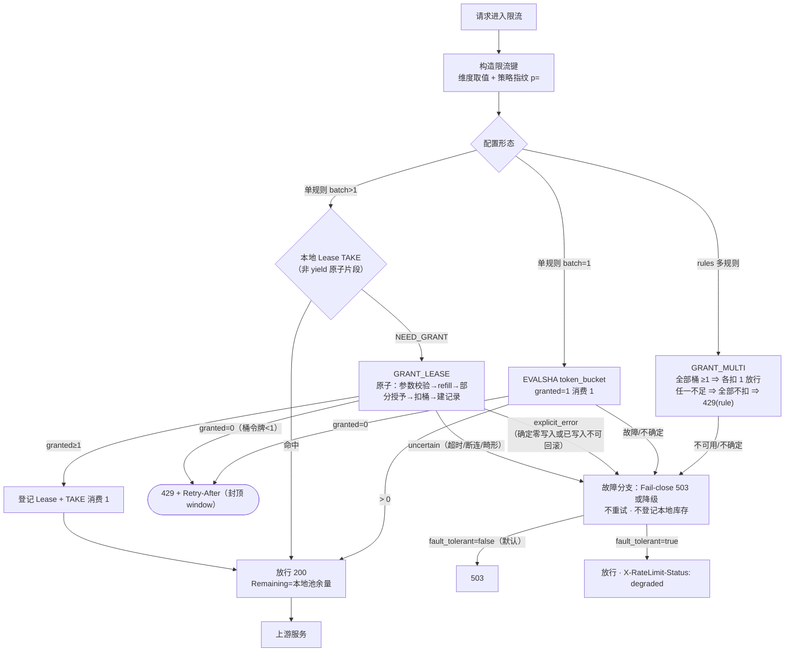

# 架构：rate-limit-advanced（V1，Phase 0–8.2 冻结版）

> 配套：`docs/design.md`（冻结设计 D1–D9 与误差推导）、`docs/PHASE6_REQUEST_INTEGRATION_REPORT.md`（集成验收）、
> `docs/reports/PHASE7_PERFORMANCE_REPORT.md`（性能）、历史报告见 `docs/reports/` 与 `docs/PHASE*_*.md`。
> 术语约定：**Lease** = Worker 本地预授权库存；**GRANT_LEASE / GRANT_MULTI** = Redis Lua 脚本；
> **CLOSED** = 本地耗尽态；**outstanding** = Worker 本地尚未消费的库存；**lost** = 已授权但无法继续使用的库存。

## 1. 整体架构

```
Client ──> Kong 副本 ×3（DB-less，每副本 2 Worker）
             │  access 阶段：rate-limit-advanced（PRIORITY 1002）
             │  限流键 = <key_prefix>:{<namespace>:p=<策略指纹>:<维度>=<值>...}
             ├── batch=1      ──> Redis Lua（token_bucket，每请求一次）
             ├── 单规则 batch>1 ──> Worker 本地 Lease（TAKE）
             │                        └─ 库存不足 ──> Redis GRANT_LEASE
             └── 多规则 ──> Redis GRANT_MULTI（多键原子，全或无）
权威层：Redis 7（单实例，Hash tokens/ts + Lease 记录 + PEXPIRE）
```

- **Worker 隔离**：每个 Worker 拥有独立的本地 Lease Pool（Lua VM 按 Worker 隔离，`lease.lua` 的
  `_pools`/`_counters` 为 Worker 私有）；Lease 只归属于创建它的 Worker；**不存在跨 Worker 共享同一份
  本地库存**；Worker 之间通过 Redis 共享全局配额状态（唯一权威）。
- **不依赖 Shared Dict**：Legacy shared-dict 聚合库存已随 Phase 8.2-A 移除。
- **核心不变量**：全局配额唯一权威在 Redis；本地库存只能来自 Redis 已授权的 Lease ⇒ 只少发、不超发；
  Worker 崩溃的未消费库存走损失方向（`granted = consumed + lost`），同样不超发。

## 2. 三种限流路径

| 模式 | 授权方式 | Redis 操作 | 本地库存 |
|---|---|---|---|
| `batch=1` | 逐请求授权 | 每请求执行 Lua（token_bucket） | 无 |
| 单规则 `batch>1` | Lease 预授权 | 库存不足时申请（实测约每 batch 个请求 1 次） | 有（Worker 私有） |
| 多规则（`rules`） | 多键原子授权 | 每请求执行 GRANT_MULTI | 无 |

实现位置：`lib/algorithm.lua` 的 `check()`（batch 解析分流）、`check_lease()`（Lease 路径）、
`check_multi()`（多规则路径）。

- **batch=1**：每请求一次 EVALSHA token_bucket；`X-RateLimit-Remaining` 恒为 0（授予的 1 个令牌被
  当前请求立即消耗）。Phase 6.4/7 实证：EVALSHA 数恰=请求数、Redis 侧 Lease 记录为 0。
- **单规则 batch>1**：预授权模式——配额以 batch 粒度预扣，本地消费零网络 I/O；**不提供与 batch=1
  相同的逐请求时序精度**，本地消费可能形成短时突发。`X-RateLimit-Remaining` = 本地池余量
  （fast path）或 granted−1（slow path）。
- **多规则**：α 强一致——每请求一次 GRANT_MULTI（组内同 hash tag ⇒ 同 slot，单脚本全检-全扣/全不扣）；
  响应为瓶颈规则口径；429 体含 `rule` 字段。多规则不使用 Lease。

## 3. 单请求决策流程（与当前代码一致）



要点：**Redis 异常（含不确定结果）不会映射为 429**；granted=0 才是确定性限流拒绝。

## 4. Token Bucket 模型

- `rate = limit / window`（每秒补充速率）；桶容量 `capacity = burst > 0 ? burst : limit`
- refill 公式：`tokens = min(capacity, old_tokens + rate × elapsed)`；补充时间戳**只前进不后退**
  （时钟回拨期间不补充、不覆盖 ts——防同一段时间二次计费）
- 部分授予：`granted = min(batch, floor(tokens))`；`tokens < 1 ⇒ granted=0`（确定性不足，不建 Lease）
- 状态存储：Redis Hash（`tokens`/`ts`）+ `PEXPIRE`（桶 TTL = 2×window）

## 5. Redis Key 设计

```
<kong:rl>:{<namespace>:p=<策略指纹>:<维度>=<值>...}     # 桶键（单规则）/ 多规则组内各规则桶
<kong:rl>:lease:{<lease_id>}                            # Lease 元数据记录
```

- **策略指纹**（FNV-1a 32 位）输入：`limit / window / burst（≤0 归一化为 limit）/ limit_by 顺序 /
  header_name（仅含 header 维度时参与）`；**batch 不参与**（运输参数，调 batch 不清空桶）
- **配置变化 ⇒ 新指纹 ⇒ 新 Pool Key**：新配置不复用旧库存；旧桶/旧 Lease 记录随 TTL 自然消亡；
  **旧 Pool 生命周期回收尚未实现（Deferred）**
- 多规则组键：组指纹 = 全部规则参数的指纹（`g=` 前缀语义），组内各桶同 hash tag ⇒ 同 slot
- `key_prefix` 可配置（默认 `kong:rl`）

## 6. Redis Lua 原子操作（Phase 2–3 冻结协议）

| 脚本 | 用途 | 要点 |
|---|---|---|
| token_bucket | batch=1 逐请求授权 | refill + 扣 1 + TTL，TIME 单调 |
| GRANT_MULTI | 多规则原子多键 | 全检-全扣/全不扣；组内同 slot 单脚本 |
| GRANT_LEASE | batch>1 预授权 | 单脚本原子：参数校验→refill→部分授予→扣桶→建 Lease 记录（OPEN）→PEXPIRE |
| RETURN_LEASE | 幂等归还 | **已实现但 V1 不接线**（Phase 5 Deferred，请求路径不调用） |

脚本双源：`lib/redis.lua` 内嵌文本与 `redis/*.lua` 独立文件 diff 校验一致。

## 7. Lease 生命周期（V1 冻结）

```text
本地无可用 Lease
       │
       v
Redis GRANT_LEASE
       ├── granted=0 ──────> 配额不足 ⇒ 429（确定性，不建 Lease）
       ├── Redis 异常 ──────> 故障分支（Fail-close 503 / 显式降级）
       ├── 结果不确定 ──────> Fail-close；不重试、不写入本地库存
       │                     （Redis 可能已扣桶并建记录 ⇒ 库存损失方向，不补偿）
       └── 授权成功（granted≥1）
                │
                v
          Worker 本地 Lease（ACTIVE，登记于创建 Worker 的 _pools）
                │
                v
             TAKE（每次消费 1，非 yield 原子）
                │
          ┌─────┴─────┐
        有库存       耗尽（remaining=0）
          │           │
          v           v
        放行        CLOSED：从可消费集合（active）摘除，
                    保留在本地 leases 表仅作诊断（不删除、不可复活）
                    └─ 后续请求触发新的 GRANT_LEASE
```

- **CLOSED 不再参与消费**；V1 状态机单向 ACTIVE→CLOSED，无 CLOSING 归还态
- **V1 不自动 RETURN**（RETURN_LEASE Lua 已实现、协议冻结，请求路径不调用）；无 idle scanner、
  无 max_lifetime、无 Worker 接管、无库存补偿
- **Redis Lease 元数据 TTL（`LEASE_TTL_MS=3600000`，内部常量，非用户配置）只约束 Redis 侧记录的
  过期，不代表库存自动归还**
- 守恒不变量：`remaining + consumed = granted`（lease-unit 25 断言守护，含无 yield 探针）

## 8. 库存账目

- 正常 Worker：`granted = consumed + outstanding`
- Worker 崩溃后：`granted = consumed + lost`（outstanding 在崩溃后归类 lost）
- 实测样本（Phase 6.5 worker-crash-e2e）：崩溃前 `10 = 4 + 6`；崩溃后 `10 = 4 + lost 6`；
  全局 `Σgranted=100 = HTTP 放行 94 + lost 6`（无接管/补偿/重新授权）
- **注意**：不能把聚合的 `granted − consumed` 全部认定为 outstanding——其中可能混有
  响应丢失等未确认部分；Phase 7 账目中该差额（7848/3.1%）按"未消费/未确认差额"口径报告。
  V1 不实现精确实时 lost 审计（Deferred）。

## 9. EVALSHA 脚本管理（Phase 2 冻结）

- 懒加载：`init_worker` 零 Redis IO，首次调用触发 `SCRIPT LOAD`；Worker 级缓存 SHA
- **仅明确 NOSCRIPT 触发 LOAD + 重试恰一次**；超时/断连/普通错误原样透传——**绝不当作 NOSCRIPT**
  （防止重复执行已成功的扣减）；重试后仍 NOSCRIPT ⇒ 明确失败
- 实证：Phase 7 全程 SCRIPT_LOAD=0（87 组）+ script-cache-selfheal-e2e（FLUSH 后三模式自愈）

## 10. 故障处理

| 场景 | 行为 |
|---|---|
| 连接拒绝/执行超时 | fault_tolerant=false（默认）⇒ 503 Fail-close；true ⇒ 降级放行 + `X-RateLimit-Status: degraded` |
| 故障响应伪装 | **不允许**：Redis 异常走故障分支，绝不返回 429 |
| GRANT 超时（不确定） | 不盲目重试、不登记本地库存；Redis 可能已执行 ⇒ 库存损失方向 |
| 已确认本地库存在故障期 | 正常 TAKE（本地零 IO，与 Redis 无关）；耗尽后新 GRANT 进故障分支 |
| 故障恢复后 | 独立请求正常申请；不重复授权（Phase 6.4 fault-recovery 实证记录增量恰 +1） |

## 11. 配置指纹与 Pool 隔离

见 §5。实测（Phase 6.3）：五维度（limit/window/burst/limit_by/header_name）各自变化 ⇒ 不同 Pool；
batch 变化 ⇒ 同 Pool；真栈配置变更后新配置首请求不复用旧库存。

## 12. 性能权衡（引用 Phase 7 正式报告，勿视为重测）

- 收益（RPS=1000 干净轮均值，Worker=2）：授权命令 20001→2002（约 9.99:1，约减少 10 倍）、
  Redis 总 QPS 4773→869（5.5×）、Redis CPU −73%、Kong CPU −23%；p50/p95 改善（0.66/1.41 → 0.50/1.16ms）
- p99 未改善（80–104ms 尾部由共享宿主机环境噪声支配，因果归因 NOT VERIFIED）
- 代价：库存留存敞口（Σgranted 255800 − 已消费 247952 = 7848 未消费/未确认差额，3.1%；崩溃时损失）、
  batch 粒度时序精度、本地突发消费特征
- 原始数据：`bench/raw/phase7/`；实验协议：`docs/bench.md`

## 13. V1 限制与 Deferred

| 类别 | 状态 |
|---|---|
| 自动 RETURN（RETURN_LEASE 接线）、idle scanner、max_lifetime、Worker 接管、库存补偿 | **Deferred（未实现）** |
| 旧 Pool 生命周期回收 | **Deferred**（随 Phase 5 RETURN 一并处理） |
| Redis Cluster（脚本缓存按节点、多键同 slot）与 HA/主从切换验证 | **未验证** |
| Prometheus 指标导出 / Tracing（`_counters` 仅为内部基础） | **未实现** |
| 长稳（>24h）与内存曲线 | **未执行** |
| `LEASE_TTL_MS` 配置化 | V1 设计保留为常量（Phase 5 引入归还时再评估） |
| K8s / 生产 HA 部署 | 本仓库仅为 Docker Compose 验证环境 |

生产边界须知（Redis 单实例切换窗口、path 高基数、清库不同步、额度头本节点视角等）见
`docs/design.md` 第 8、9 节与 `docs/DEPLOYMENT.md`。
