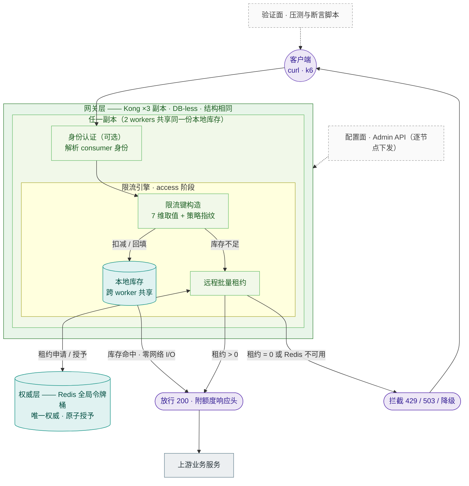
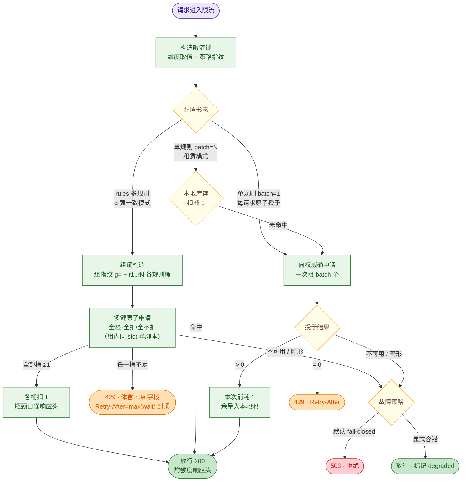
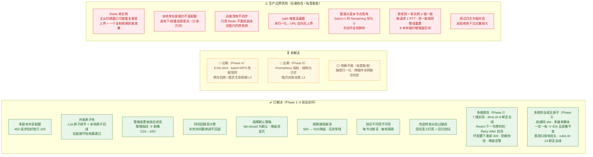

# 架构图与问题状态总览

> 配套文档：`docs/design.md`（设计取舍与误差分析）、`reports/phase-1-correctness.md`（验收证据）、`test/first-commit.md`（人工剧本）。
> 图示约定：**实线** = 已实现并验证的数据/控制流；**虚线** = 管理面/验证面；节点配色 = 分区（绿=已解决，黄=进行中/远期，红=生产边界）。
> 图内不出现文件名，概念 → 实现的对照见「表 0」。

## 图 0 · 模块对照（图外注释）

| 图中概念 | 对应实现 |
|---|---|
| 身份认证 | key-auth 插件（PRIORITY 1250，先于限流 1002 执行） |
| 限流引擎 | handler（判定与响应）+ algorithm（限流键构造与决策主流程） |
| 本地库存 | ngx.shared.kong_rl（32m，环境变量注入；跨 worker 共享，每副本一份） |
| 远程批量租约 | resty.redis 连接池 + 内嵌 EVAL 令牌桶脚本 |
| 权威层 | Redis 7 单实例（宿主 6380→容器 6379），Hash tokens/ts + PEXPIRE |
| 配置面 | Admin API `POST /config`（DB-less 逐节点下发） |
| 验证面 | bench/*.sh + k6/*.js（配额、延迟、多维、XFF） |

---

## 图 1 · 总体架构

**核心不变量**：全局配额唯一权威在 Redis；本地库存只能来自 Redis 已授权的批量租约 ⇒ **只少发、不超发**，少发上界 ≈ 节点数 × batch。
**限流键格式**：`kong:rl:{<namespace>:p=<策略指纹>:<维度>=<值>:…}` —— 策略一变即新键，旧桶/旧库存随 TTL 自然淘汰。

---

## 图 2 · 单请求决策流程

---

## 图 3 · 问题状态三区（已解决 / 未解决 / 生产边界）

---

## 表 1 · 已解决的问题（证据锚点）

| 问题 | 解法 | 验证证据 |
|---|---|---|
| 多副本共享配额 | Redis 单点原子授予 + 本地租约 | batch=1：450 请求恰好 100 放行 |
| 并发扣减原子性 | Lua 单次 EVAL 读-算-扣-写；本地 incr 原子扣减/负值回滚 | 守恒核算：授出 600 = 消耗 90 + 本地 510，桶 400.005 分毫不差 |
| 配置变更继承旧状态 | 策略指纹进 hash tag，策略变即新键 | 同 namespace 切 limit 1000→100 后恰放行 100（修复前实测 116 超发） |
| 时间回拨重复计费 | 补充时间戳只前进不后退 | 预置未来 ts → 不补充、ts 不被覆盖 |
| 故障默认放行（违背既定策略） | fail-closed 默认，degraded 显式选择 | 停 Redis：默认 503×3 不达上游；显式容错 200×3 + degraded |
| 故障路径崩溃（500） | nil 判定前移 | 故障日志干净，traceback 计数 0 |
| 测试不可控不可信 | 每节点请求数断言 + 每轮 namespace 隔离 + 双源脚本同步 | 断言 150×3 通过；VUS=2 破坏用例 exit 1；跨轮 namespace 段不同 |
| 伪造 X-Forwarded-For 疑虑 | 信任语义文档化 + 语义钉死回归 | 20 个伪造 XFF → 1×200 + 19×429 同桶 |
| 多维限流取值与键形（Phase 2） | 7 维实测进 dims.sh 回归 | route/service key 含 UUID；consumer 三身份独立；8 断言全绿 |
| 伪窗口 Reset / 无界 Retry-After（Phase 2） | Reset=下一令牌 Unix 秒且与 Retry-After 同口径；Retry-After≤window | 429 时 Reset−now=36=Retry-After；极端配置封顶恰 3600 |
| 坏配置运行时 500（Phase 2） | entity_checks 下发即 400 | header_name 缺失 → 400 带字段定位；合法配置 201 对照 |
| Redis 畸形返回（Phase 2） | 纯函数防御校验 → 故障分支 | 10 类畸形全拒 + 2 合法样例 |
| 多规则全或无原子（Phase 3） | α 强一致：组内同 slot 多键单脚本"全检-全扣/全不扣" | 一空一有 ⇒ 429 且双桶 tokens 均不变；全够 ⇒ 各扣 1 |
| 组指纹换桶（Phase 3） | 组指纹=全部规则参数 FNV-1a | 仅改 r2.limit ⇒ g=3acf5710→4df638e4，旧桶不再命中 |
| 多规则响应语义（Phase 3） | 瓶颈口径头 + 429 体 rule 字段 + 封顶 | Remaining=0/Reset≈+6（瓶颈 r2）；429 rule=rules[1]；封顶=3600 |

## 表 2 · 未解决的问题

| 问题 | 现状 | 计划 |
|---|---|---|
| 每次全量上传脚本文本 | EVAL 而非 EVALSHA | Phase 4 |
| 性能矩阵 / 长稳 / 非均匀流量 | 仅正确性基线（多规则模式尚未进矩阵） | Phase 4（产出 bench/results.md） |
| 指标与结构化日志 | 无 Prometheus；RL-DEBUG 调试态 | Phase 5 |
| 库存回收 / 租赁生命周期 | FLUSHDB 残留、节点退出损失（仅单规则 batch>1 受影响；多规则模式无本地租约不受影响） | Phase 4 L2 优雅归还 / Phase 5 L3 对账 |
| 多规则本地租约（β 增强） | 多规则恒强一致，每请求 1 RTT | 后续独立 change |

## 表 3 · 生产边界须知（部署/运维前必读）

| 边界 | 影响 | 须知 / 缓解 |
|---|---|---|
| Redis 单实例 | 主从切换窗口可能重复发放（上界 ≈ 一个复制周期的发放量） | 需要强一致就上 Raft 类方案是过度设计；至少评估 Sentinel + 诚实告知业务 |
| 本地库存 = 租约 | 副本下线/重启丢失已租未用额度（少发方向，不超发） | 容量规划时按"少发上界 N×batch"留裕量 |
| 清库不同步 | 只清 Redis 不重启副本 → 旧租约继续放行（同策略下合法但绕过"重置配额"意图） | 运维"重置配额"必须重启副本或换 namespace |
| path 维度基数 | `limit_by=[path]` 的 key 随 URL 空间无界增长 | 生产建议先归一化或避免 path 维度（当前明确不支持归一化） |
| 额度头口径 | Remaining/Reset 均为本节点视角；batch=1 时 Remaining 恒 0 | 客户端勿将其当全局精确值；429 的 Retry-After 才是权威等待建议 |
| 多规则强一致代价 | 每请求 1 RTT 无快路径；改任一条规则 = 整组配额重置 | 低 rate 关键接口适用；容量规划时知晓 RTT 成本；改规则前评估重置影响 |
| 配置下发非原子 | DB-less 逐节点 POST，秒级不一致窗口 | 变更窗口内行为短暂不一致；先全部下发再恢复流量 |
| 错误配置的爆炸半径 | 指纹使策略变更=新桶满血 | 改配置前评估"配额重置"业务影响；需继承余量用 namespace |

---

**一句话总结**：正确性地基已经打牢并全部验证（多副本共享配额、原子性、策略身份、故障策略）；**语义外皮与可观测性是下一刀**（Phase 2），**性能证据与库存生命周期是再下一刀**（Phase 4）；生产化之前必须带着"表 3"的每一条去和业务方对齐。
