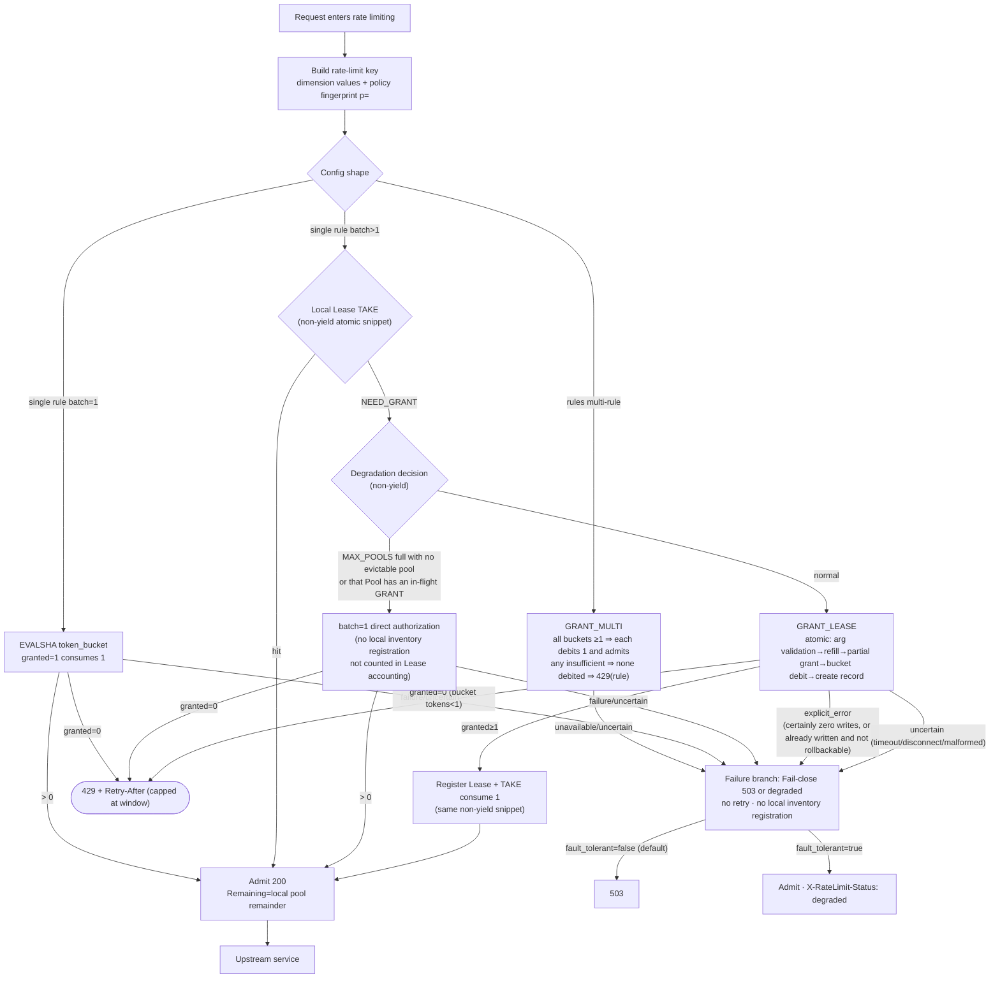

# Architecture: rate-limit-advanced (V1, Phase 0–8.2 frozen + Gates 2/3/4 remediation)

> Companion documents: `docs/design.md` (design document and layered error derivation),
> `docs/REMEDIATION.md` (remediation gate freeze records), `docs/reports/PHASE7_PERFORMANCE_REPORT.md`
> (performance); historical reports in `docs/reports/` and `docs/PHASE*_*.md`.
> Terminology conventions: **Lease** = Worker-local pre-authorized inventory;
> **GRANT_LEASE / GRANT_MULTI** = Redis Lua scripts; **CLOSED** = locally exhausted state;
> **EXPIRED** = expired and removed (**the only state that produces discarded**: unconsumed
> inventory is counted into discarded, not returned to Redis); **EVICTED** = Pool
> reclamation event (whole-pool deletion, limited to empty pools with no active Lease, zero
> inventory loss, **not a Lease state**);
> **outstanding** = inventory the Worker holds locally but has not yet consumed;
> **discarded** = unconsumed inventory discarded by EXPIRED (not returned to Redis; only
> EXPIRED produces discarded; EVICTED empty-pool reclamation has zero inventory loss);
> **lost** = inventory already granted but no longer usable (Worker crash, etc.);
> **uncertain** = Redis may have debited but the Worker did not register (no retry, no registration).

## 1. Overall Architecture

```
                      ┌───────────────────────────────────────────┐
 Client ─────────────▶│ Kong replicas ×3 (DB-less, 2 Workers per replica)    │
                      │                                           │
                      │  Kong#1            Kong#2       Kong#3    │
                      │  ┌──────────┐     ┌──────────┐ ┌──────────┐│
                      │  │WorkerA   │     │WorkerA   │ │WorkerA   ││
                      │  │ _pools   │     │ _pools   │ │ _pools   ││  ← Lease pools are
                      │  │WorkerB   │     │WorkerB   │ │WorkerB   ││    Worker-private
                      │  │ _pools   │     │ _pools   │ │ _pools   ││    (isolated Lua VMs)
                      │  └──────────┘     └──────────┘ └──────────┘│
                      │        access phase: rate-limit-advanced     │
                      └───────────────┬───────────────────────────┘
                                      │ three request paths (see §2)
        ┌─────────────────────────────┼─────────────────────────────┐
        ▼                             ▼                             ▼
  batch=1 (per request)            single rule batch>1                  multi rules (per request)
  EVALSHA token_bucket        Worker-private Lease TAKE          EVALSHA GRANT_MULTI
        │                     (insufficient→GRANT_LEASE)                  │
        └──────────────┬──────────────────────┴───────────────┬─────┘
                       ▼                                      │
              ┌──────────────────┐        Redis failure (timeout/disconnect)│
              │    Redis 7 (standalone)│◀──────── Fail-close 503 ──┘
              │ global token bucket (sole authority)│        (fault_tolerant=true ⇒
              │ Lease metadata (1h TTL)│          explicit degraded fail-open)
              └──────────────────┘
```

- **Worker isolation**: each Worker owns an independent local Lease Pool (Lua VMs are
  isolated per Worker; `_pools`/`_counters` in `lease.lua` are Worker-private); a Lease
  belongs only to the Worker that created it; **no sharing of the same local inventory
  across Workers**; Workers share global quota state through Redis (the sole authority).
- **No dependency on Shared Dict**: the legacy shared-dict aggregated inventory was
  removed with Phase 8.2-A.
- **Core invariant**: the sole authority for the global quota is Redis; local inventory
  can only come from Leases already authorized by Redis. Provided the Redis authorization
  state remains continuously valid (no replication failover rollback, no data reset) and
  the accounting basis is consistent, **cumulative admissions ≤ the amount of
  authorization Redis has confirmed debiting** (derived, premised statement, docs/design.md §4.2);
  under-admission has multiple sources (Worker crash lost, GRANT uncertain, EXPIRED
  discarded — EVICTED empty-pool reclamation has zero inventory loss); over-admission is
  only possible in the failure rollback window; a crashed Worker's unconsumed inventory
  goes to the loss direction (`granted = consumed + lost`).

## 2. Three Rate-Limiting Paths

| Mode | Authorization | Redis operation | Local inventory |
|---|---|---|---|
| `batch=1` | Per-request authorization | Lua executed per request (token_bucket) | None |
| Single rule `batch>1` | Lease pre-authorization | Requested when inventory is insufficient (measured about once per batch requests) | Yes (Worker-private) |
| Multi-rule (`rules`) | Multi-key atomic authorization | GRANT_MULTI executed per request | None |

batch>1 additionally has two **degraded direct-connection** paths (frozen at Gates 2/3;
both reuse the existing batch=1 semantics, do not register local inventory, and are not
counted in Lease accounting):

| Trigger | Behavior |
|---|---|
| MAX_POOLS (10000/Worker) full with no evictable empty pool | That request uses batch=1 direct authorization; **no 429, no 503** (an attacker-driven high-cardinality key cannot deny legitimate users this way); log `pool_cap_degraded` |
| That Pool already has an in-flight GRANT (plan B: single in-flight per Pool) | Concurrent requests use batch=1 direct authorization; log `inflight_degraded` |

Implementation locations: `check()` in `lib/algorithm.lua` (batch parsing and
dispatching), `check_lease()` (Lease path + degradation decision), `check_multi()`
(multi-rule path).

- **batch=1**: one EVALSHA token_bucket per request; `X-RateLimit-Remaining` is always 0
  (the 1 granted token is consumed immediately by the current request). Phase 6.4/7
  evidence: EVALSHA count exactly = request count, and Redis-side Lease records are 0.
- **Single rule batch>1**: pre-authorization mode — quota is debited in batch granularity
  in advance and local consumption has zero network I/O; **it does not provide the same
  per-request temporal precision as batch=1**, and local consumption can form short-lived
  bursts. `X-RateLimit-Remaining` = local pool remainder (fast path) or granted−1
  (slow path).
- **Multi-rule**: α strong consistency — one GRANT_MULTI per request (same hash tag within
  the group ⇒ same slot; single-script check-all / debit-all or debit-nothing); the
  response uses the bottleneck rule's basis; the 429 body contains a `rule` field.
  Multi-rule does not use Leases.

## 3. Per-Request Decision Flow (consistent with the current code)



Key point: **Redis anomalies (including uncertain results) are never mapped to 429**;
only granted=0 is the deterministic rate-limit rejection.

## 4. Token Bucket Model

- `rate = limit / window` (refill rate per second); bucket capacity
  `capacity = burst > 0 ? burst : limit`
- refill formula: `tokens = min(capacity, old_tokens + rate × elapsed)`; the refill
  timestamp **only moves forward, never backward** (no refill and no ts overwrite during
  clock rewind — prevents double billing over the same period)
- Partial grant: `granted = min(batch, floor(tokens))`; `tokens < 1 ⇒ granted=0`
  (deterministic insufficiency, no Lease created)
- State storage: Redis Hash (`tokens`/`ts`) + `PEXPIRE` (bucket TTL = 2×window)

## 5. Redis Key Design

```
<kong:rl>:{<namespace>:p=<policy fingerprint>:<dimension>=<value>...}     # bucket key (single rule) / per-rule bucket in a multi-rule group
<bucket key>:lease:<lease_id>                                 # Lease metadata record (shares the bucket key's hash tag ⇒ same slot)
```

- **Dimension-value encoding** (Gate 4 task A): `:` `{` `}` `%` in `<value>` are escaped
  by `lib/keys.lua encode_value` into `%3A` `%7B` `%7D` `%25` (other bytes verbatim);
  multi-dimensional combinations do not collide, the key is stable for the same input,
  and dimension values cannot break the hash tag structure;
  the Lease key = the bucket key with `:lease:<lease_id>` appended, same slot as the
  bucket key (eliminates CROSSSLOT; the old format `<kong:rl>:lease:<lease_id>` is
  deprecated, and old records disappear naturally with the 1h TTL).

- **Policy fingerprint** (FNV-1a 32-bit) input: `limit / window / burst (≤0 normalized to
  limit) / limit_by order / header_name (participates only when the header dimension is
  present)`; **batch is excluded** (transport parameter; changing batch does not empty
  buckets)
- **Config change ⇒ new fingerprint ⇒ new Pool Key**: new config does not reuse old
  inventory; old buckets / old Lease records die naturally by TTL;
  **old Pool lifecycle reclamation is not yet implemented (Deferred)**
- Multi-rule group key: group fingerprint = fingerprint over all rule parameters
  (`g=` prefix semantics); all buckets in the group share the same hash tag ⇒ same slot
- `key_prefix` is configurable (default `kong:rl`)

## 6. Redis Lua Atomic Operations (Phase 2–3 frozen protocol)

| Script | Purpose | Key points |
|---|---|---|
| token_bucket | batch=1 per-request authorization | refill + debit 1 + TTL, TIME monotonic |
| GRANT_MULTI | Multi-rule atomic multi-key | check-all / debit-all or debit-nothing; same slot within the group, single script |
| GRANT_LEASE | batch>1 pre-authorization | Single-script atomic: arg validation→refill→partial grant→bucket debit→create Lease record (OPEN)→PEXPIRE |
| RETURN_LEASE | Idempotent return | **Implemented but not wired in V1** (Phase 5 Deferred, not invoked on the request path) |

Dual-source scripts: the embedded text in `lib/redis.lua` and the standalone files in
`redis/*.lua` are diff-verified to be identical.

## 7. Lease Lifecycle and the Local Pool (V1 frozen + Gates 2/3 remediation)

```text
No locally available Lease (NEED_GRANT)
        │
        ├── Degradation decision (non-yield): MAX_POOLS full with no evictable pool / that Pool has an in-flight GRANT
        │        └──> batch=1 direct authorization (no local inventory registration, not counted in Lease accounting)
        │
        v
Redis GRANT_LEASE
        ├── granted=0 ──────> insufficient quota ⇒ 429 (deterministic, no Lease created)
        ├── Redis exception ──────> failure branch (Fail-close 503 / explicit degradation)
        ├── Uncertain result ──────> Fail-close; no retry, no local inventory write (uncertain listed separately)
        │                     (Redis may have debited the bucket and created a record ⇒ loss direction, no compensation)
        └── Grant succeeded (granted≥1)
                │
                v
          Worker-local Lease (ACTIVE, registered in the creating Worker's _pools;
          active Lease count per Pool ≤ 1 ⇒ worst-case TAKE scan O(1))
                │
                v
              TAKE (consumes 1 each time, non-yield atomic; lazily evaluates expiry on TAKE)
                │
        ┌───────┼──────────┐
        │       │          │
        v       v          v
      Consuming  Exhausted   created_at + max_age/1000 < now
        │       │          │
        │       v          v
        │    CLOSED      EXPIRED: removed from active, unconsumed inventory counted into
        │    (removed,      discarded (counted once, not returned to Redis)
        │    kept for diagnostics)
        │       └── subsequent requests trigger a new GRANT_LEASE
        │
        └── Pool level: active empty and idle beyond max_age ⇒ Timer reclaims the whole pool;
            under MAX_POOLS pressure only empty pools with no active Lease are evicted (EVICTED, zero inventory loss);
            60s low-frequency Timer fallback (per-round processing count capped, in-flight GRANTs skipped, callback exceptions isolated)
```

- **State machine**: local Lease states ACTIVE→CLOSED / EXPIRED (when an EXPIRED Lease is
  removed, unconsumed inventory is counted into discarded, counted once, not returned to
  Redis — **only EXPIRED produces discarded**);
  **EVICTED is a Pool reclamation event, not a Lease state**: under MAX_POOLS pressure
  only empty pools with no active Lease are evicted (CLOSED remaining=0, EXPIRED already
  counted ⇒ zero inventory loss); there is no CLOSING return state
- **V1 does not auto-RETURN** (the RETURN_LEASE Lua is implemented, the protocol is
  frozen, and the request path does not call it); no idle scanner, no max_lifetime (the
  local max_age=2×window is implemented and belongs to the Pool reclamation dimension),
  no Worker takeover, no inventory compensation
- **The Redis Lease metadata TTL (`LEASE_TTL_MS=3600000`, internal constant, not
  user-configurable) only constrains expiry of the Redis-side record; it does not mean
  automatic inventory return**
- Conservation invariant: `remaining + consumed = granted` (guarded by lease-unit's 50
  assertions, including non-yield probes)
- **Layered invariants**: production-code control paths (single in-flight flag + non-yield
  register/TAKE/state-flip snippets) maintain the invariants; `_counters` accounting is
  synchronized with state flips (discarded counted only once);
  **`invariants()` is a check function actively invoked by tests (lease-unit /
  algorithm-lease-unit / smoke / probe scripts), not a production runtime assertion —
  production paths do not call it**

## 8. Inventory Accounting (identity frozen at Gate 2)

- **Global identity**: `confirmed_granted = consumed + outstanding + discarded`
  (confirmed_granted only counts GRANTs the Worker received and registered; each state
  flip + removal from active + counting completes within the same non-yield snippet ⇒
  discarded is never double-counted)
- **uncertain listed separately**: GRANT timeouts/disconnects (Redis may have debited,
  Worker not registered) are not counted in the identity; no retry, no registration
  (frozen semantics); under-admission direction, ≤ batch per event
- After a Worker crash: `granted = consumed + lost` (outstanding is reclassified as lost)
- Measured sample (Phase 6.5 worker-crash-e2e): before the crash `10 = 4 + 6`; after the
  crash `10 = 4 + lost 6`; globally `Σgranted=100 = HTTP admitted 94 + lost 6` (no
  takeover/compensation/re-authorization)
- **Note**: the aggregate `granted − consumed` must not all be treated as outstanding —
  it may include unconfirmed parts such as lost responses; in the Phase 7 accounting that
  difference (7848/3.1%) is reported under the "unconsumed/unconfirmed difference" basis.
  V1 does not implement a precise real-time lost audit (Deferred).

## 9. EVALSHA Script Management (Phase 2 frozen)

- Lazy loading: `init_worker` has zero Redis I/O; the first invocation triggers
  `SCRIPT LOAD`; SHA cached per Worker
- **Only an explicit NOSCRIPT triggers LOAD + retry exactly once**;
  timeouts/disconnects/ordinary errors are passed through as-is — **never treated as
  NOSCRIPT** (to prevent re-executing an already-successful debit); if it is still
  NOSCRIPT after the retry ⇒ explicit failure
- Evidence: across Phase 7, SCRIPT_LOAD=0 (87 groups) + script-cache-selfheal-e2e
  (self-heal of all three modes after FLUSH)

## 10. Failure Handling

| Scenario | Behavior |
|---|---|
| Connection refused / execution timeout | fault_tolerant=false (default) ⇒ 503 Fail-close; true ⇒ degraded fail-open admission + `X-RateLimit-Status: degraded` |
| Failure response masquerading | **Not allowed**: Redis anomalies go to the failure branch and never return 429 |
| GRANT timeout (uncertain) | No blind retry, no local inventory registration; Redis may have executed ⇒ loss direction |
| Confirmed local inventory during a failure | Normal TAKE (zero local I/O, independent of Redis); after exhaustion, new GRANTs go to the failure branch |
| After failure recovery | Independent requests apply normally; no duplicate authorization (Phase 6.4 fault-recovery evidence records increments of exactly +1) |

## 11. Policy Fingerprint and Pool Isolation

See §5. Measured (Phase 6.3): changes to each of the five dimensions
(limit/window/burst/limit_by/header_name) ⇒ different Pools; a batch change ⇒ same Pool;
after a real-stack config change, the first request with the new config does not reuse
old inventory.

## 12. Performance Trade-offs (citing the Phase 7 official report; do not treat as a re-run)

- Gains (RPS=1000 clean-run means, Worker=2): authorization commands 20001→2002
  (≈ 9.99:1, about 10× reduction), Redis total QPS 4773→869 (**about 81.8% lower**),
  Redis CPU −73%, Kong CPU −23%; p50/p95 improved (0.66/1.41 → 0.50/1.16ms)
- p99 not improved (the 80–104ms tail is dominated by shared-host environment noise;
  causal attribution NOT VERIFIED)
- Cost: inventory-stranding exposure (Σgranted 255800 − consumed 247952 = 7848
  unconsumed/unconfirmed difference, 3.1%; lost on crash), batch-granularity temporal
  precision, local burst consumption characteristics
- Raw data: `bench/raw/phase7/`; experiment protocol: `docs/bench.md`

## 13. V1 Limitations and Deferred

| Category | Status |
|---|---|
| Automatic RETURN (RETURN_LEASE wiring), idle scanner, Worker takeover, inventory compensation | **Deferred (not implemented)** |
| Local Pool lifecycle reclamation (MAX_POOLS=10000/Worker, max_age=2×window expiry, empty-pool EVICTED eviction, 60s Timer) | **Implemented (frozen at Gates 2/3; discarded counted once; invariants() is a test check function)** |
| Redis Cluster (per-node script cache, multi-key same slot — the key layer's same-slot was delivered by Gate 4 task A) and HA/replication-failover verification | **Key layer fixed; Cluster behavior unverified** |
| Prometheus metrics export / Tracing (`_counters` is only an internal basis) | **Not implemented** |
| Long-duration stability (>24h) and memory curves / Worker RSS | **Not executed** |
| Configurability of `LEASE_TTL_MS` | V1 design keeps it a constant (re-evaluated when Phase 5 introduces returns) |
| K8s / production HA deployment | This repository is only a Docker Compose verification environment |
| N1 (dimension-value 256-truncation collision) / N2 | **Stay on record; not implemented without approval** |

For production boundary notes (Redis single-instance failover window, high path
cardinality, out-of-sync data reset, this-node-view quota headers, etc.) see docs/design.md
sections 8 and 9 and `docs/DEPLOYMENT.md`.
