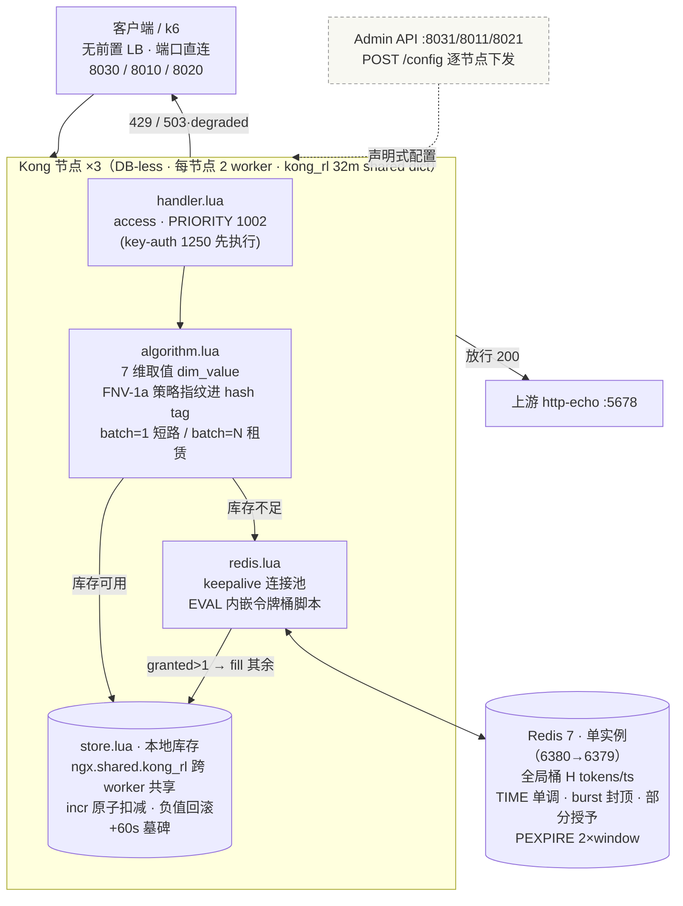
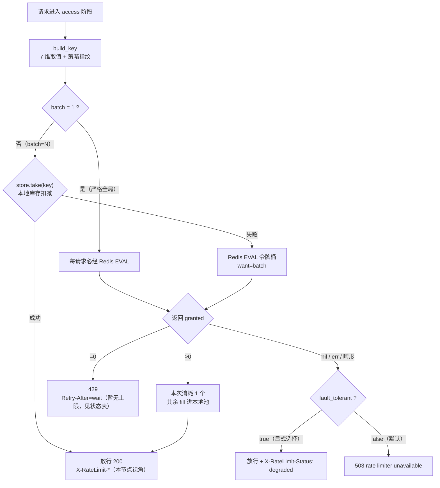
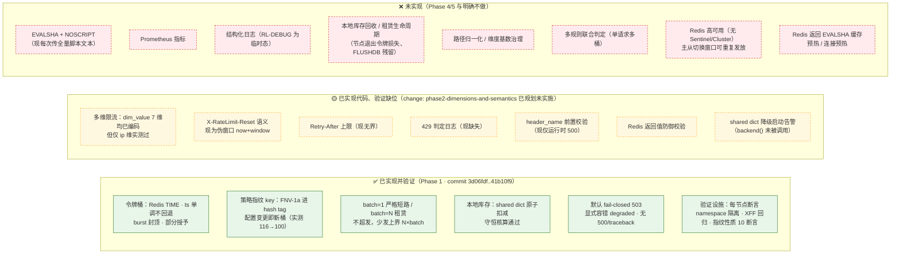

# 架构图与实现状态

> 配套文档：`docs/design.md`（设计取舍与误差分析）、`reports/phase-1-correctness.md`（验收证据）、`test/first-commit.md`（人工剧本）。
> 图示约定：**实线** = 已实现并验证（Phase 1）；**虚线框** = 计划中/未实现（对应 change 或 Phase 4/5）。

## 1. 总体架构（部署拓扑 + 单节点内部）

**核心不变量**：全局配额唯一权威在 Redis；本地库存只能来自 Redis 已授权的批量租约 ⇒ **只少发、不超发**，少发上界 ≈ 节点数 × batch。
**Key 格式**：`kong:rl:{<ns>:p=<FNV-1a 指纹>:<dim>=<val>:…}`——策略一变即新桶，旧桶/旧库存随 TTL 淘汰。

## 2. 单请求决策流程

## 3. 实现状态总览

### 状态明细表

| 状态 | 项 | 说明 |
|---|---|---|
| ✅ | 令牌桶算法 | Redis TIME、ts 单调、burst 封顶、部分授予、wait 计算（`lib/redis.lua` 内嵌脚本） |
| ✅ | 策略指纹 | FNV-1a 32bit → 8 位 hex 进 hash tag；负值归一化；`burst=0≡limit` 等价（`lib/algorithm.lua`） |
| ✅ | batch 两种模式 | batch=1 每请求必经 Redis（日志证实 redis_grant=450）；batch=N 租赁少发上界 |
| ✅ | 本地库存 | shared dict 跨 worker；原子 incr；守恒核算通过；墓碑 TTL 防 key 驻留 |
| ✅ | 故障策略 | 默认 fail-closed(503)；显式 degraded；nil 判定前移无 500；畸形流程无异常栈 |
| ✅ | 验证设施 | quota.sh 每节点断言 + namespace 隔离；xff.sh；指纹 10 断言；守恒探针 |
| 🟡 | 多维限流 | 7 维取值已编码（`dim_value`），仅 ip 维验证过 → `bench/dims.sh`（Phase 2 任务 4.x） |
| 🟡 | Reset/Retry-After/429 日志/防御校验/降级告警/header_name 前置校验 | 全部已设计（change: phase2-dimensions-and-semantics），未实施 |
| ❌ | EVALSHA | 每次全量上传脚本文本（Redis 侧有脚本缓存语义但未利用） |
| ❌ | 可观测性 | 无 Prometheus 指标；RL-DEBUG 为调试态非结构化日志 |
| ❌ | 库存生命周期 | FLUSHDB 后同策略旧库存仍有效（少发方向）；节点退出令牌无回收 |
| ❌ | 基数治理 | path 维度未归一化，`limit_by=[path]` 高基数风险 |
| ❌ | 多规则联合 | 单请求仅一个桶 |
| ❌ | Redis 高可用 | 单实例；主从切换窗口内可能重复发放（design.md §4.6 诚实划界） |

## 4. 已知边界（诚实声明，对应 design.md §4.6/§11）

- Lua 原子 ≠ 主从切换强一致：切换窗口内可能重复发放，上界 ≈ 一个复制周期内的发放量。
- 本地库存是租约不是配额：节点下线/重启即丢失（少发方向）；FLUSHDB 清不掉 worker 库存（必须重启 Kong 才彻底隔离）。
- `batch=1` 时 `X-RateLimit-Remaining` 恒为 0（granted−1 的既有口径，Phase 2 的 remaining 文档化不改变数值）。
