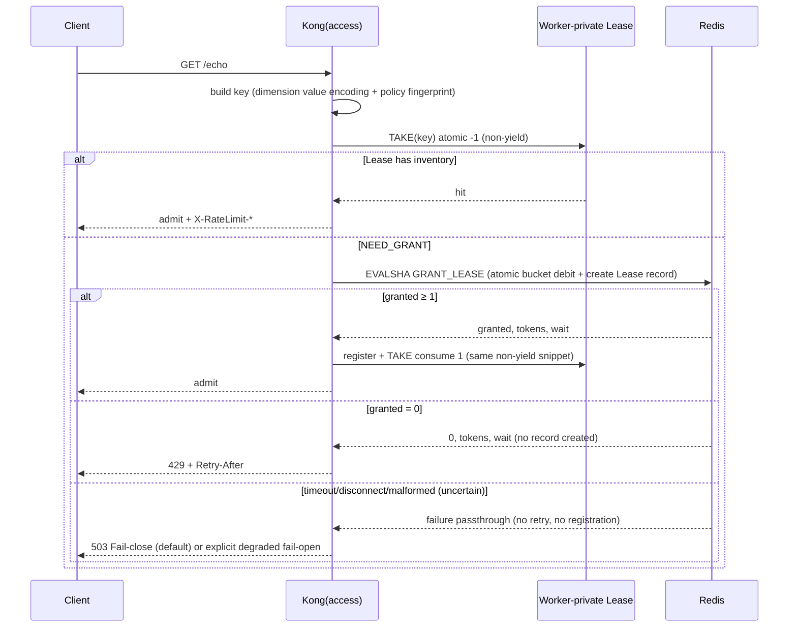
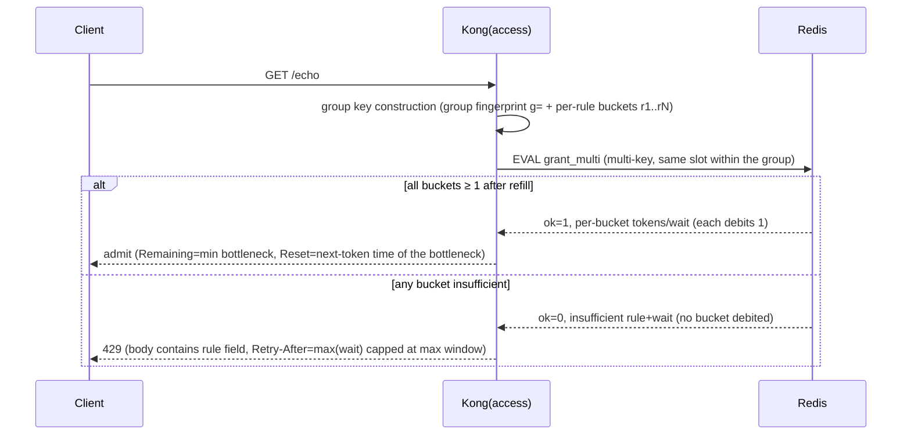

# Distributed Cluster Rate-Limiting Plugin —— Design Document

> Status: **Current V1 (Gate 5 document alignment, based on remediation/hardening)**.
> The goal of this document is not to "prove I am done", but to "prove I know where I am
> and what trade-offs I made at each step".
> Status marker conventions: **[Historical]** = early design trade-offs (conclusions still
> valid, implementation carriers may have changed); **[Current V1]** = actually implemented
> in the current code; **[Deferred]** = explicitly not implemented.
> Basis for quantitative numbers: **measured / derived / estimated / NOT VERIFIED** are
> labeled item by item and never mixed.

---

## 1. Problem and Boundaries

### 1.1 The Problem Being Solved

With multi-replica gateways (validated with N=3 in this design), per-node in-memory rate
limiting gives each replica its own copy of the quota, so the **effective admission = N ×
limit** and the quota is effectively meaningless. A quota pool shared across replicas is
needed.

### 1.2 Explicitly Out of Scope (Boundaries)

| Out of scope | Reason |
|---|---|
| Control plane / config distribution (the Konnect approach) | A platform-side capability; this design assumes config is pushed via Kong declarative configuration |
| Multi-tenant quota management and billing | Orthogonal to the rate-limiting kernel; belongs to the business layer |
| Cross-slot transactions in Redis Cluster | This design uses hash tags to guarantee a single key lands in a single slot; cross-key consistency is out of scope |
| Global fair queuing / waiting in queue | The goal is "reject fast", not "queue and admit"; queuing amplifies tail latency |
| Microsecond-precise window alignment | The token bucket refills continuously and needs no window alignment — that is itself one reason for choosing it |

### 1.3 Acceptance Criteria

1. With `batch=1`, the total admissions across N replicas are **strictly equal** to the
   quota (reproducible, assertable) [Current V1: measured, bench/quota.sh]
2. With `batch>1`, total admissions **do not exceed** the amount of authorization Redis has
   confirmed debiting (see §4.2 premises and §4.3 error basis) [Current V1]
3. Over-limit returns `429` + `Retry-After`; normal requests return `X-RateLimit-*`[Current V1: measured]
4. Config can be changed dynamically without restart[Current V1: measured]
5. As `batch` grows, p99 and Redis load decrease monotonically and the quota under-admission
   rate increases monotonically (to be shown experimentally)[Historical goal; measured
   conclusions in §8.3: Redis load reduction and under-admission exposure are empirically
   confirmed, p99 monotonicity is dominated by environment noise and unproven (NOT VERIFIED)]

---

## 2. Solution Overview [Current V1]

```
                          ┌────────────────────────────┐
   Client round-robin ───▶│  Kong #1 (DB-less)         │──┐
                          │  Worker A  Worker B         │  │
                          │  [Lease pool A][Lease pool B]│  │  ← Worker-private, invisible to each other
                          └────────────────────────────┘  │
                          ┌────────────────────────────┐  │       ┌─────────────┐
                          │  Kong #2                    │  ├──────▶│   Redis 7   │
                          │  [Lease pool][Lease pool]   │  │EVALSHA│ ┌─────────┐ │
                          └────────────────────────────┘  ├───────│ │global token bucket│ │
                          ┌────────────────────────────┐  │  atomic │ └─────────┘ │
                          │  Kong #3                    │──┘       │Lease metadata │
                          │  [Lease pool][Lease pool]   │────────▶ └─────────────┘
                          └────────────────────────────┘                │
                                   │  local inventory sufficient ⇒ zero Redis I/O        ▼
                                   └──────────────────────────────▶ upstream service
                               Redis failure ⇒ Fail-close 503 (default) / explicit degraded fail-open
```

**In one sentence**: the global quota is the "main warehouse" (Redis, the sole authority),
and each Worker's Leases are its own "pocket change". Spend change without leaving home;
only when the change runs out fetch a batch from the warehouse. **Workers do not share
change with each other**; the only thing shared is the Redis main warehouse.



**Key invariant [Current V1]**: every token consumed by an admission comes from some
confirmed Redis debit (Lease pre-authorization or batch=1 direct authorization). Provided
the Redis authorization state remains continuously valid (no replication failover
rollback, no data reset) and the accounting basis is consistent, **cumulative admissions ≤
cumulative authorized debits in Redis** (derived, see §4.2); over-admission risk exists
only in the failure rollback window (§4.6), and it is not an unconditional identity.

**The multi-rule mode (α strong consistency, Phase 3) has no such chain**: when `rules` is
non-empty, no local inventory and no fast path are used; each request performs one Redis
multi-key atomic Lua call (`grant_multi`):



The all-or-nothing check and debit are completed within the same script (Redis single
thread ⇒ no intermediate state is visible), so **the multi-rule path has no under-admission
error** — the cost is 1 RTT per request and no local inventory.
(For contrast: under-admission error exists only on the single-rule batch>1 Lease
pre-authorization path.)

---

## 3. Algorithm Selection

| Algorithm | Burst control | Memory | Distributed implementation difficulty | Boundary spikes | Verdict |
|---|---|---|---|---|---|
| Fixed-window counting | Poor (up to 2×limit across window boundaries) | O(1) | Very low (INCR + EXPIRE) | **Yes**, amplified by QPS | ❌ This is exactly the official plugin's problem |
| Sliding-window log | Exact | O(limit) (stores each request timestamp) | Medium (ZSET three-step operations) | None | ⚠️ Memory unacceptable at large quotas |
| Sliding-window counter (dual-window weighted) | Fair | O(1) | Low | Significantly mitigated, still approximate | Alternative |
| **Token bucket** | **Good (burst configurable)** | **O(1)** | **Low (one script)** | None | ✅ **Selected** |

Three reasons for choosing the token bucket:

1. **O(1) memory**; even 100k keys are only a few fields — fits gateway scenarios with
   high key cardinality.
2. **Continuous refill, no window boundaries**; the "59.9s and 60.1s each admit a full
   batch" spike cannot occur.
3. **burst and rate can be explained in business language**: rate = average rate,
   burst = allowed transient burst. The `limit`/`window` config items map directly to
   rate = limit/window, burst = limit.

Counter-example (written here to show "I know where the other options fall short"):
with a fixed window, if limit=100/60s, an attacker fires 100 requests at 59.9s and another
100 at 60.1s — **200 admitted within 1 second**, twice the quota. This is a known weakness
of the official OSS plugin.

---

## 4. Distributed Consistency and Error Analysis (the core of this document)

### 4.1 Single-Node Correctness

All quota changes are completed within one Lua script; Redis single threading guarantees atomicity:

```lua
tokens = min(burst, tokens + (now - ts) * rate)   -- refill
if tokens >= want then tokens = tokens - want end -- grant
```

**Time is taken from `redis.call('TIME')`**, not from the application node's `ngx.now()`.
Clock drift across N gateway nodes is typically tens to hundreds of milliseconds; if each
node computed refill with its own clock, a node whose clock is 1 second fast would
arbitrarily claim `rate` extra tokens. Using Redis's single clock source eliminates this
variable.

### 4.2 Why (Under the Given Premises) There Is No Over-Admission [Current V1, derived]

**Variable definitions (uniform across this document)**: `N` = number of Kong replicas;
`W` = Workers per replica; `W_total = N × W` = total cluster Workers; `k` = batch (tokens
requested per GRANT); `B` = bucket capacity (`burst>0 ? burst : limit`); `R` = refill rate
(limit/window).

**Object and scope of statistics**: the conclusions below all apply to a **single logical
key** (the bucket for one namespace + fingerprint + dimension combination) and its
authorized inventory; the global total across keys is the sum of the per-key conclusions.

- Every admission consumes 1 token, and a token can only come from some authorization
  "already debited from the global bucket" (batch=1 direct or batch>1 GRANT_LEASE, atomic
  in a single Redis script).
- Authorization is atomic; cumulative authorization `G ≤ supply`; local consumption ≤
  registered authorization ⇒ cumulative admissions ≤ G ≤ supply.
- **Premise (must be stated explicitly)**: the Redis authorization state remains
  continuously valid — no replication failover rollback, no data reset, consistent
  accounting basis. While this premise holds, "never admit tokens not debited by Redis"
  is a constructive guarantee.
- **Exceptions when the premise fails**: short-lived over-admission is possible within the
  master-replica async replication rollback window (§4.6); when a fingerprint change
  leaves old and new buckets coexisting, the same logical dimension has quotas on both
  bucket sets, and the effective admission cap is their sum (may exceed the single-version
  quota within the upgrade window; convergence time = old bucket TTL 2×window, see §6).

### 4.3 Quantifying Under-Admission (stranded tokens) [Current V1, derived + estimated layering]

Composition of under-admission (never returned to Redis; direction is one-way):

| Component | Per-event bound | Cumulative bound | Rigor |
|---|---|---|---|
| Transient stranding (confirmed and registered, unconsumed inventory) | ≤ k per Worker per key | ≤ W_total × k | **Derived upper bound** (premises below) |
| Pool expiry (EXPIRED) discarded (Gate 3) | ≤ k per Worker per key per Lease | Depends on the number of Lease generations | Estimated |
| Worker crash lost | ≤ k per Worker | Depends on the number of crashes | Estimated |
| GRANT uncertain (Redis debited, Worker not registered) | ≤ k per event | **No closed upper bound** (no retry / no registration is frozen semantics; event count depends on failure rate) | Estimated + NOT VERIFIED |

**Transient stranding ≤ W_total × k is a derived upper bound, whose premises are**:
①at most 1 active Lease per Worker per Pool at any time (Gate 3 invariant: single in-flight
GRANT per Pool + non_yield register/TAKE snippets; guarded by the `invariants()` test
check, see §4.9 three-layer distinction); ②each Lease has `granted ≤ k`; ③no RETURN (not
wired in V1). When the premises hold, the bound holds; the premises are maintained by
**production-code control paths and state accounting** (single in-flight GRANT flag +
non-yield register/TAKE/state-flip snippets + `_counters` counter synchronization) and are
**actively verified in tests via `invariants()`** (invoked by lease-unit /
algorithm-lease-unit / smoke / probe scripts; not invoked at production runtime, see §4.9
three-layer distinction), rather than by protocol guarantees.

**"Per-window cumulative under-admission ≤ W_total × k" is not a strict upper bound**: the
per-event magnitude of discarded/lost/uncertain is bounded (≤k), but the number of events
per window depends on traffic shape and failure rate, so cumulative under-admission has
no closed formula. The engineering estimation basis is as follows (**counting only the
transient stranding term**, with W_total = 3×2 = 6; excluding uncertain/crash cumulative
terms; long-run distribution NOT VERIFIED):

| limit | k | Transient stranding upper bound (estimated) | Transient inventory exposure ratio (derived upper bound) |
|---|---|---|---|
| 1000 | 20 | 120 | 12% (120/1000) |
| 1000 | 50 | 300 | 30% (300/1000) |
| 100 | 2 | 12 | 12% (12/100) |
| 10000 | 50 | 300 | 3% (300/10000) |

(Basis consistent with the README: **exposure ratio = derived upper bound of transient
stranding / limit**; it is not the actual utilization nor a lower bound of window
utilization; actual stranding depends on traffic shape; for a measured exposure sample see
the Phase 7 report 3.1%.)

This table is one basis for parameter choices: error is a relative quantity, so `k` must
scale with `limit`. **Note that it differs from N·k under the early "N nodes share one
inventory" model**: in V1 the Lease is Worker-private, so the stranding upper bound scales
with the total Worker count W_total, not separately with the replica count N.

### 4.4 Automatic Value of `batch` [Current V1: `lib/algorithm.lua resolve_batch`]

```lua
k_auto = clamp(floor(limit / 50), 1, 50)
```

- `limit=100` → `k=2`; `limit=1000` → `k=20`; `limit=10000` → `k=50` (capped).
- Choosing 50 as the denominator is equivalent to tolerating **per-Worker** transient
  stranding of 1/50 = 2%; per §4.3, worst-case cluster transient stranding = W_total × k =
  W_total/50 (e.g. 6 Workers ⇒ 12%) — this is an **estimated upper bound** (excluding
  uncertain/crash cumulative terms); see the §4.3 table for exposure ratio numbers.
- The cap of 50 avoids burst amplification from oversized single grants (§4.5) and longer
  Redis per-script processing time.

### 4.5 Burst Amplification [Current V1, derived]

Local inventory is "already drawn, pending consumption" tokens, and **a Worker can release
them instantaneously within its own inventory range** (local consumption burst), so the
worst transient burst for the cluster on a single key is:

```
burst_max = B + W_total · k
```

`B=1000, W_total=6, k=20` → 1120, a 12% amplification (**derived upper bound**, premises
as in §4.3). If `k` approaches `limit` (equivalent to full localization), the burst
amplifies to `B + W_total·B`, which is **unacceptable**, so `k` must be significantly
smaller than `limit`. This constraint, together with §4.3, pins the range of `k` from
both sides.

### 4.6 Redis Failures and Replication Failover

| Scenario | Behavior | Mitigation |
|---|---|---|
| Redis unreachable | Default fail-closed (503, quota safety first) | Can explicitly set `fault_tolerant=true` in exchange for admission + `X-RateLimit-Status: degraded` |
| Master-replica async replication | Master debits but dies before syncing → tokens "revive" after failover → short-lived over-admission | Accept and record; or use AOF `appendfsync always` (latency cost) |
| During replication failover | Connection errors → failure branch (default 503 / explicit degraded admission) | Connection pool + timeout (1s) ensures fast failure |

**This document does not claim "strong consistency"**. The accurate statement is: atomic
under a single master; duplicate grants are possible within the failover window; the
over-admission upper bound ≈ the amount granted within one replication cycle before the
switch. Honestly marking the boundary withstands scrutiny better than claiming strong
consistency.

### 4.7 Comparison with "Using Raft for Quota Replication" (why not the heavier solution)

> This section is written for people who have done Raft: I know what the heavy solution
> looks like and why it is not worth it here.

| | Redis single master + local inventory | Raft-replicated quota |
|---|---|---|
| Write latency | 1 RTT (and amortized by batch) | Majority-quorum RTT, usually ≥ Redis single master |
| Availability | Master dies → transient degradation | A surviving minority can still write |
| Implementation complexity | One Lua script | Membership management, snapshots, log compaction, split-brain handling |
| Quota reclamation | Automatic via TTL | A reclamation protocol must be designed |

Conclusion: rate limiting is a scenario that **tolerates brief failure** (the harm of
brief rejection or a few seconds of degradation is far smaller than dragging the gateway
down; whether a Redis failure defaults to 503 or degraded admission is explicitly chosen
via `fault_tolerant`); the strong consistency Raft would buy is over-engineering here.
**Knowing when not to use the heavy solution matters more than knowing how to use it.**

### 4.8 Multi-Rule Joint Evaluation (α strong-consistency mode)

**Requirement**: one request is simultaneously constrained by multiple independent quotas
(e.g. consumer global 100/hour + consumer×path 10/hour); **admit only if every bucket has
a token; if any bucket is insufficient, no bucket is debited** (all-or-nothing).

**Why it must converge to a Redis server-side single script** (the most important
trade-off in this design):

- Worker-local in-memory tables have no multi-key atomic primitive (only single-key
  operations), so "check A and B first, then debit" has a TOCTOU race: passing the check
  ≠ actually debiting; two concurrent requests may both admit based on the same stale
  snapshot. Debit-verify-rollback (rollback on failure) yields only eventual consistency
  plus a crash-window leak (under-admission direction), not strong consistency.
- Redis single thread + single Lua script ⇒ the in-script "check-all / debit-all or
  debit-nothing" is indivisible; no other request can interleave between check and debit
  — this is the only layer that can provide that atomicity.

**Group key (same slot within the group)**:

```
kong:rl:{<ns>:g=<group fingerprint>:r<i>:<dim>=<val>:…}
```

- Group fingerprint = FNV-1a(all rules' limit/window/burst/limit_by/header_name
  concatenated in order). Any rule parameter change ⇒ the whole group maps to new keys
  (changing one rule = whole-group quota reset; the old bucket is evicted by TTL).
- All buckets in the group share the same hash tag ⇒ same Redis Cluster slot ⇒ multi-key
  EVAL is feasible (the forward design made for the single-rule hash tag pays off here;
  a hard prerequisite for multi-rule on Cluster deployments).
- Bucket structure is isomorphic to the single-rule bucket (`tokens`/`ts`); the refill
  formula is reused (TIME monotonic, burst capped).

**Grant semantics**: each bucket debits 1 (batch is meaningless here; the schema forces
batch∈{0,1}); lease-level "take min" enhancements (β: local multi-pool leases +
debit-verify-rollback) are explicitly left for a later change; v1 is purely strong
consistency.

**Response basis**: on admission `Remaining = min(remaining of all buckets)` (bottleneck
rule), `Reset = next-token time of the bottleneck bucket`; the 429 body's `rule` field
names the insufficient rule (human-readable `rules[2]:consumer+path`),
`Retry-After = max(insufficient buckets' wait)` capped at `max(insufficient buckets' window)`.

**Cost statement**: the multi-rule mode costs 1 RTT per request (no fast path, no batch
amortization); changing any rule = whole-group quota reset. Verification: `bench/rules.sh`
(core assertion "R1 empty + R2 non-empty ⇒ 429 and neither bucket's tokens change").

### 4.9 Lease Lifecycle and the Local Pool Model [Current V1, frozen at Gates 2/3]

**Pool**: one Pool per Worker per logical key (Worker-private `_pools` in `lease.lua`);
created on first GRANT and snapshots `max_age = 2×window` (milliseconds, effective only
on first creation). `MAX_POOLS = 10000/Worker` (frozen value): when the cap is reached,
**ACTIVE Pools are not evicted**, no 429 and no 503; that request degrades to batch=1
direct authorization (no local inventory registration, not counted in Lease accounting);
eviction order = evict empty pools with no active Lease first; the TAKE hot path is O(1)
(active Lease count per Pool ≤ 1).

**Lease states (local)**: `ACTIVE → CLOSED` (exhausted, removed from the consumable set,
kept for diagnostics, not revivable) / `EXPIRED` (`created_at + max_age/1000 <
ngx.now()`, removed). **Only EXPIRED's unconsumed inventory is counted into discarded**
(counted once, not returned to Redis, under-admission direction).

**Pool reclamation events (not Lease states)**: `EVICTED` = the Pool is deleted whole —
under MAX_POOLS pressure **only empty pools with no active Lease are evicted** (CLOSED
Leases have remaining=0 and EXPIRED has already been counted into discarded, ⇒ **EVICTED
has zero inventory loss** and produces no discarded); or when active is empty and idle
beyond max_age, the 60s Timer reclaims the whole pool. Cleanup path: TAKE/GRANT lazy
evaluation + low-frequency Timer fallback (per-round processing count capped, in-flight
GRANTs skipped, callback exceptions isolated, Worker-exit fallback).

**Concurrent GRANT (plan B, frozen)**: only one in-flight GRANT is allowed per Pool at a
time; concurrent requests during it degrade to batch=1 direct ⇒ upper bound of active
Leases per Pool = 1, worst-case TAKE scan O(1).

**Accounting identity**: `confirmed_granted = consumed + outstanding + discarded`
(confirmed_granted only counts GRANTs the Worker received and registered; GRANT
timeouts/lost responses are listed separately as uncertain and **not counted** in this
identity); after a Worker crash, outstanding is reclassified as lost.

**Three-layer distinction of invariants**:
1. **Production-code control paths** maintain the invariants — single in-flight GRANT
   flag + non-yield register/TAKE/state-flip snippets (`state` flips first, immediately
   removed from active, counters completed within the same snippet, no yield point);
2. **State accounting** (`_counters`: tokens_granted/consumed, discarded_tokens, etc.) is
   synchronized with those snippets; discarded is counted only once;
3. **`invariants()` is a check function actively invoked by tests** (lease-unit /
   algorithm-lease-unit / smoke / probe scripts), **not a production runtime assertion** —
   production paths do not call it; the invariants are guaranteed in production by the
   code structure of paths 1/2 and independently verified in tests by invariants().

---

## 5. Request Path and Performance Budget

Rate limiting happens in the `access` phase (before forwarding upstream), so it stacks
directly onto the gateway's per-request overhead.

```
request → TLS → route match → [access: rate limit] → upstream connection → response
                              ↑ this design's budget: target < 0.2ms (fast path)
```

| Path | Operations | Expected overhead |
|---|---|---|
| fast path (Lease has inventory) | Worker-local TAKE (non-yield atomic snippet) + composing response headers | ~10–20 μs, no network I/O[estimated] |
| slow path (NEED_GRANT) | Redis EVALSHA GRANT_LEASE + keepalive reuse | Determined by RTT, local Redis ~0.2–0.5ms[estimated] |
| Direct-connection degradation (MAX_POOLS full / in-flight GRANT occupied) | batch=1 direct authorization (no local inventory registration) | Same order as batch=1 slow path[derived] |
| Rejection path | Compose 429 + headers | Same order as fast path[estimated] |

The slow-path trigger probability ≈ `1/k`, so **average overhead ≈ (1-1/k) × fast +
(1/k) × slow**. This is the entire economics of the `batch` parameter.

**Measured (Phase 7, RPS=1000 clean-run means, Worker=2, citing
[PHASE7_PERFORMANCE_REPORT.md](reports/PHASE7_PERFORMANCE_REPORT.md); do not treat as a
re-run)**: batch=10 vs batch=1 —— p50 0.50 vs 0.66ms, p95 1.16 vs 1.41ms (improvement,
measured); p99 87.1 vs 82.8ms (no improvement; the tail is dominated by shared-host
environment noise, **attribution NOT VERIFIED**); authorization commands 2002 vs 20001
(≈ 9.99:1); Redis total QPS 869 vs 4773 (−81.8%); Kong CPU −23%, Redis CPU −73% (see §8.3).

---

## 6. Configuration Model and Dynamic Push

```yaml
plugins:
  - name: rate-limit-advanced
    config:
      limit: 1000          # Requests allowed per window
      window: 60           # Window length (seconds)
      burst: 0             # 0 = equal to limit
      batch: 0             # 0 = auto, 1 = strict consistency
      limit_by: [ip]       # Dimension combination
      header_name: X-Api-Key   # Required when limit_by includes header
      namespace: rl
      fault_tolerant: false    # Default; true = explicitly choose degraded admission on Redis failure
      # Multi-rule joint evaluation (α strong-consistency mode, Phase 3): mutually exclusive with limit_by, batch only 0/1, at most 8 rules
      # rules:                            # all-or-nothing atomic evaluation across all buckets (see §4.8)
      #   - limit: 100
      #     window: 3600
      #   - limit: 10
      #     window: 3600
      #     limit_by: [consumer, path]
      redis:
        host: redis
        port: 6379
        database: 0
        timeout: 1000
```

**Semantic definitions (easy to overlook but must be spelled out)**:

- Changing `limit` (or `window`/`burst`/`limit_by`) at runtime: the key's **policy
  fingerprint** changes with it = switching to a new bucket outright. The new bucket
  starts full; the old bucket and old local inventory are evicted by TTL and are **not
  inherited by the new policy** (this fixes the "after shrinking the quota, old inventory
  keeps admitting, causing over-admission" problem: measured 116 > 100 before the fix).
  The cost is that the quota "resets" at the moment of the config change; when you need
  "change limit but inherit remaining balance" semantics, control it explicitly with
  `namespace` — only a combination with an unchanged namespace and unchanged other
  parameters hits the same bucket.
- Changing `limit_by`: the key composition changes, equivalent to switching buckets; the
  old bucket expires naturally by TTL.
- Changing only `batch`: the fingerprint excludes batch (a transport parameter that does
  not constitute bucket identity); the bucket and existing inventory are **kept**.

**Coexistence risk of DB-less node-by-node push [Current V1]**: when config is POSTed
node by node via the Admin API, a pushed node immediately works with the new fingerprint
while un-pushed nodes still work with the old fingerprint — **the same logical dimension
is accounted on both bucket sets separately, and the effective admission cap = the sum of
the old and new buckets** (until the old bucket dies with the 2×window TTL). Mitigation
recommendations: push to all three nodes back-to-back within the same low-traffic window;
after pushing, verify the three nodes' configs agree (cross-check the Admin API /config
against rate-limiting behavior); avoid staying in the "partially updated nodes" state for
long.

---

## 7. Observability and Failure Modes

**Response headers**

```
X-RateLimit-Limit: 1000         # configured limit
X-RateLimit-Remaining: 986      # remaining from this node's view (approximate, see below)
X-RateLimit-Reset: 1762...      # Unix seconds when the next token is available (this node's view; approximate on the fast path)
Retry-After: 3                  # only on 429, seconds; ≤ window, same basis as Reset−now
X-RateLimit-Status: degraded    # only when explicitly tolerating a Redis failure and admitting
```

**`Remaining` is this node's view**: the fast and slow path bases agree (on the slow path
`granted−1` exactly equals the local inventory after registration). Promising clients an
"overall remaining" would mislead them, so the documentation explicitly says it is
`local_remaining`. (A global view would cost an extra RTT and is itself jittery; V1 does
not provide it — trade-off in §9.)

**`Reset` is "when the next token becomes available"**, not a window reset — the token
bucket has no window concept: the Redis path is exact (the server returns the wait
duration), the local path is approximate (inventory present ⇒ now; just took the last
token ⇒ one refill period `window/limit`). `Retry-After` is capped at `window` seconds
(≥1 token is guaranteed to refill within one window), and on 429 `Reset−now ≈ Retry-After`.
A 429 is a deterministic rejection and logs a notice on every occurrence
(key/limit/batch), distinguishing it from Redis failures.

**Failure matrix**[Current V1]

| Failure | Detection | Behavior |
|---|---|---|
| Redis timeout/unreachable | `resty.redis` 1s timeout / connection failure | Default fail-closed (503) + error log; with `fault_tolerant=true`, admit + degraded header |
| GRANT result uncertain (timeout/disconnect/malformed response) | Per-request passthrough | No retry, no local inventory registration (frozen semantics); under-admission direction, ≤ k per event |
| Local Pool pressure (MAX_POOLS full with no evictable pool / in-flight GRANT occupied) | Degradation decision before GRANT | That request degrades to batch=1 direct authorization (no local inventory registration; no 429 and no 503, so an attacker-driven high-cardinality key cannot deny legitimate users this way)[Current V1, frozen at Gates 2/3] |
| Local Pool expiry (max_age = 2×window) / idle reclamation (60s Timer) | Timer + lazy evaluation | Expired Leases' unconsumed inventory is counted into discarded (not returned to Redis); Active Pools are not reclaimed |
| Config missing `header_name` | Rejected at push time by schema entity_checks (400) | Fail fast; bad config never enters the runtime |
| Redis Lease metadata TTL expiry (1h) | Whole key deleted on the Redis side | **Only the metadata disappears**; no token recovery, no inventory return (no RETURN in V1) |

---

## 8. Experiment Design and Results

The full experiment protocol is in `docs/bench.md`. The core is **controlling variables**:
change only `batch`, fix everything else.

### 8.1 Experiment Matrix [Historical plan → actual execution follows Phase 7]

| ID | batch | Purpose |
|---|---|---|
| M0 | No plugin | Baseline (bare gateway overhead) |
| M1 | 1 | Upper-bound cost of strict consistency |
| M2 | 10 | Benefit of Lease pre-authorization (the actually executed batch>1 tier) |
| M3 | Multi-rule | Strong-consistency contrast |

(The early plan's M2=5/M3=20/M4=auto is [Historical]; Phase 7 actually executed
M0 / batch=1 / batch=10 / multi-rule; the auto formula was verified by unit tests and not
separately load-tested.)

### 8.2 Results

Official results are in
**[docs/reports/PHASE7_PERFORMANCE_REPORT.md](reports/PHASE7_PERFORMANCE_REPORT.md)**
(same-basis k6 constant-arrival-rate, raw data in `bench/raw/phase7/`; this document does
not re-run or copy tables). Phase 1 Legacy data (docs/results.md) is for historical
comparison only and does not represent the current implementation.

### 8.3 Conclusions

batch=10 vs batch=1 (RPS=1000, Worker=2, measured): authorization commands 20001→2002
(≈ 9.99:1), Redis total QPS 4773→869 (−81.8%), Redis CPU −73%, Kong CPU −23%;
p50/p95 improved (0.66/1.41 → 0.50/1.16ms, measured); **p99 showed no improvement
(82.8 vs 87.1ms); the tail is dominated by shared-host environment noise, causal
attribution NOT VERIFIED**. Cost: inventory-stranding exposure (7848 of 255800 grants
unconsumed/unconfirmed, 3.1%, measured aggregate basis) and batch-granularity temporal
precision. The auto default of limit/50 is conservatively acceptable under the §4.3
estimation basis.

---

## 9. Trade-off Table (the section the take-home assignment requires to be explicit)

| Decision | Chose | Gave up | Why |
|---|---|---|---|
| Algorithm | Token bucket | Sliding-window log's exactness | O(1) memory + no boundary spikes; precision is sufficient |
| Quota location | Redis single master | Redis Cluster / Raft | Complexity does not match benefit; rate limiting tolerates brief failure |
| Consistency | Single-master atomic + explicit error basis (derived upper bound / estimated / NOT VERIFIED layering) | Claiming strong consistency | Strong consistency requires Raft and buys no business benefit |
| Latency optimization | Worker-private Lease pre-authorization + batched draws | Exact per-request debits | Redis load ÷k; the cost is controlled under-admission (stranding/loss exposure, §4.3) |
| Remaining semantics | This node's view (fast/slow paths agree) | Globally exact | A global value costs an extra RTT and is itself jittery |
| Reset basis | When the next token is available (Unix seconds) | Window reset / bucket-refill time | The token bucket has no window concept; refill is a huge number at large burst with no retry value |
| Retry-After | Capped at window seconds | Uncapped | ≥1 token refills within one window; longer wait suggestions are meaningless |
| Failure policy | Default fail-closed (503) | Default fail-open | Quota correctness first; availability can be explicitly bought via `fault_tolerant=true` |
| Malformed Redis responses | Defensive validation → failure branch | Treat as 429 / silently fall back | Data anomalies should not trigger deterministic rejection, nor silently admit |
| Missing header_name | 400 at push time (entity_checks) | Runtime 500 | Fail fast; bad config should not enter the runtime |
| Config activation | Declarative whole-config push | Fine-grained hot reload | Kong DB-less's native way; good enough |
| Multi-dimensional keys | Dimension-value escape encoding (`:`/`{`/`}`/`%` → %XX) + 256 truncation | Full percent encoding / normalization / masking | Unambiguous encoding eliminates concatenation collisions and hash-tag breakage (Gate 4); normalization is business semantics belonging to upper layers; the 256-truncation cross-dimension collision (N1) stays on record, unfixed |

---

## 10. Comparison with the Official Kong rate-limiting Plugin

| Dimension | Official OSS | This design |
|---|---|---|
| Algorithm | Fixed-window counting | Token bucket |
| Boundary spikes | Present (up to 2×limit at window boundaries) | None |
| Redis calls | 1 per request (`policy: redis`) | 1 per k requests |
| Multi-replica precision | Relies on Redis `INCR`; exact but 1 RTT per request | Exact (k=1) or bounded error (k>1), tunable |
| Burst control | Implicitly determined by window size | `burst` explicitly configurable |
| Failure degradation | No explicit statement | Default fail-closed (503); `fault_tolerant=true` explicit degradation + response header marker |
| Error statement | Not given | The document gives a layered error basis (derived upper bound + estimated + measured exposure sample, §4.3/§8.3) |

**This is not "reinventing the wheel"**: the official implementation answers "is there a
solution at all"; this design answers "can the latency cost of one Redis call per request
be amortized, and how much precision remains after amortization". The answer to the
latter must be given with formulas + experiments.

---

## 11. What Is Still Missing for Ready for Production

Listed by priority; this part is "I know what I have not finished", which says more about
engineering judgment than a feature list:

1. **Redis high availability**: currently a single instance. Production needs
   Sentinel/Cluster + connection-string parsing, and an explicit over-admission window
   during replication failover (see 4.6).
2. **Hot-key splitting**: `limit_by=ip` at a NAT egress compresses hundreds of thousands
   of users onto a few keys, saturating a single Redis core on one key. Requires
   hash-sharding keys into several sub-buckets and summing (introduces extra error).
3. **Cardinality governance**: the key cardinality of `limit_by=path` is the URL space;
   path normalization is mandatory (`/user/123` → `/user/:id`), otherwise Redis memory
   grows with the number of URLs.
4. **Observability integration**: push metrics to Prometheus (`kong_http_...`) instead of
   relying only on response headers.
5. **Quota reclamation**: local inventory is lost when a node goes offline
   (under-admission direction); wasteful at large quotas. [Current V1 status]
   Local Pools already have lifecycle management (Gate 3: max_age=2×window expiry
   (EXPIRED unconsumed inventory counted into discarded), idle 60s Timer reclamation,
   MAX_POOLS evicting empty pools as EVICTED — zero inventory loss);
   **automatic RETURN to Redis is still Deferred** (the RETURN_LEASE protocol is frozen
   but not wired); precise cross-crash reconciliation (lost audit) is Deferred.
6. **Clock**: the Redis-side refill uses Redis TIME (script arguments contain no local
   time, verified at Gate 1); local `ngx.now()` is used only for Lease local expiry
   evaluation (created_at + max_age; expiry only discards inventory and never creates
   tokens ⇒ not a source of over-admission, derived), `X-RateLimit-Reset`, and logs.
   The Reset header differs slightly across nodes (acceptable).
7. **Load testing**: numbers on the local Docker network are not production; at least one
   cross-machine (real RTT) validation is needed.
8. **Security**: with `limit_by=header`, clients can forge the header to bypass limits;
   signatures or trusted sources are needed.

---

## 12. Appendix: Key Design and Lease Metadata Model [Current V1, aligned with Gate 4 task A]

**Bucket key** (single rule) / **per-rule bucket keys within the group** (multi-rule):

```
kong:rl:{<namespace>:p=<policy-fingerprint>:<dim1>=<v1>:<dim2>=<v2>}
```

- `{}` wraps the hash tag, guaranteeing the same logical key lands in the same slot under
  Redis Cluster (although currently a single instance, this is zero-cost forward
  compatibility).
- **`p=<8-hex-chars>` is the policy fingerprint** (FNV-1a-32, input = limit, window,
  resolved burst, limit_by order, header_name (header dimension only)): any rate-limiting
  parameter change means a new bucket; the old bucket and old local inventory are no
  longer inherited by the new policy (measured before the fix: after changing limit, 116
  admitted > 100; the extra 16 all came from the old config's bucket and inventory).
  The fingerprint excludes `batch` — batch is a transport parameter and does not
  constitute bucket identity.
- **Dimension-value encoding (Gate 4 task A)**: `:` `{` `}` `%` are escaped by
  `lib/keys.lua encode_value` into `%3A` `%7B` `%7D` `%25` (other bytes verbatim; Redis
  keys are binary-safe) ⇒ multi-dimensional combinations do not collide, the key is
  stable for the same input, and dimension values cannot break the hash tag structure.
  Header dimension values still undergo 256-character truncation (**the cross-dimension
  truncation collision N1 stays on record, unfixed**).
- Example (measured `redis-cli KEYS` output):

```
kong:rl:{rl:p=8039753e:ip=172.20.0.1}   # limit=1000 / window=3600 / limit_by=ip
kong:rl:{rl:p=50780f62:ip=172.20.0.1}   # limit=100  / window=3600 / limit_by=ip
                                        # same dimension values, different policy → two independent buckets
```

**Lease metadata key and record model** (from task A, shares the bucket key's hash tag ⇒
same slot on Cluster):

```
<bucket key>:lease:<lease_id>                  # shares the bucket key's hash tag ⇒ same slot (old format deprecated)
```

- The record is a Redis Hash, created atomically by GRANT_LEASE, 5 fields: `lease_id` /
  `pool_key` / `granted` (numeric string) / `status` (`OPEN`) / `created_at` (Redis TIME
  float string); after RETURN, `return_requested` is appended (RETURNED state).
- **TTL**: `LEASE_TTL_MS = 3600000` (1h, internal constant, not user-configurable), set
  via `PEXPIRE` at GRANT; **TTL expiry deletes the whole key = only the metadata
  disappears**, with no token recovery and no inventory return (no RETURN in V1);
  RETURNED records are kept until the original TTL (not reset) = an idempotency
  protection window.
- **Metadata cost (measured basis, Gate 4 task B)**: per-key self memory ≈264–280B;
  batch average including keyspace ≈308–320B/entry (48B key measured); 1M entries
  used_memory 306MB (measured); estimated 330–350MB (±10%) for realistic key lengths.

**Redis Cluster support boundary**:

- **In place (key layer, Gate 4 task A)**: the bucket key and Lease key share the hash
  tag ⇒ both keys on the same slot, GRANT_LEASE's two-key script is no longer CROSSSLOT;
  dimension-value encoding guarantees high-cardinality dimension values do not break the
  hash tag.
- **Unverified / Deferred**: per-node script-cache management (SCRIPT LOAD only reaches a
  single node), CLUSTER redirect semantics, MOVED handling, Cluster memory and
  replication traffic — **the V1 verification environment is standalone; independent
  verification is required before Cluster deployment (NOT VERIFIED)**; README and
  architecture.md carry the same basis.
