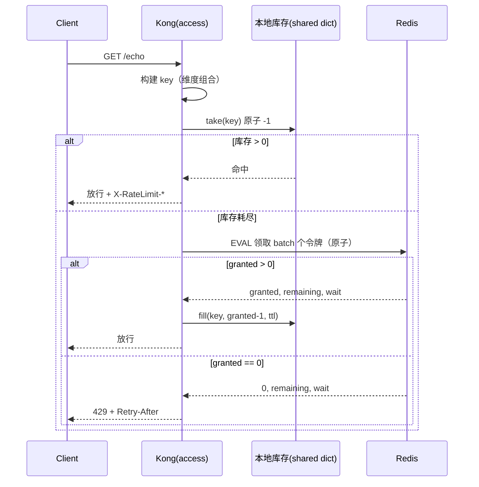
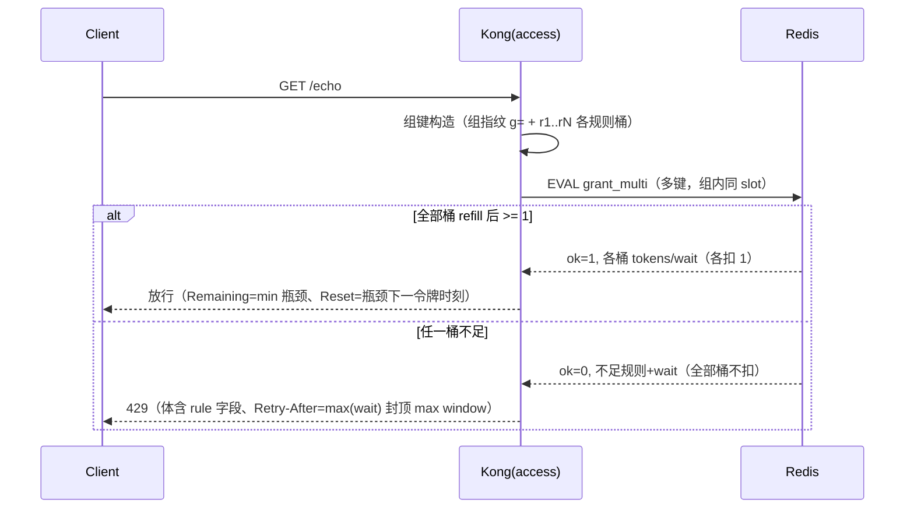

# 分布式集群限流插件 —— 设计文档

> 状态：骨架 + 已完成部分。**标 `⟨TODO⟩` 的地方是需要你跑完实验后填真实数字的。**
> 本文档的目标不是"证明我做完了"，而是"证明我知道自己在哪一步做了取舍"。

---

## 1. 问题与边界

### 1.1 要解决的问题

多副本网关（本方案按 N=3 验证）下，单机内存限流会让每个副本各自持有一份配额，
**实际放行量 = N × limit**，配额形同虚设。需要一个跨副本共享的配额池。

### 1.2 明确不做的事（边界）

| 不做 | 原因 |
|---|---|
| 控制面/配置分发（Konnect 那套） | 属于平台侧能力，本方案假设配置通过 Kong 声明式配置下发 |
| 多租户配额管理与计费 | 与限流内核正交，属于业务层 |
| Redis Cluster 的跨 slot 事务 | 本方案用 hash tag 保证单 key 落在单 slot，跨 key 的一致性不在范围内 |
| 全局公平队列 / 排队等待 | 目标是"快速拒绝"，不是"排队放行"；排队会引入尾延迟放大 |
| 精确到微秒的窗口对齐 | 令牌桶是连续补充，不需要窗口对齐，这本身是选它的理由之一 |

### 1.3 验收口径

1. `batch=1` 时，N 个副本的总放行数 **严格 等于** 配额（可复现、可断言）
2. `batch>1` 时，总放行数 **不超过** 配额（误差方向单一）
3. 超限返回 `429` + `Retry-After`，正常请求返回 `X-RateLimit-*`
4. 配置可动态修改，不重启
5. `batch` 增大时，p99 与 Redis 负载单调下降，配额少发率单调上升（用实验证明）

---

## 2. 方案总览

```
                         ┌──────────────┐
   客户端轮询 ───────────▶│  Kong #1     │──┐
                         │  ┌────────┐  │  │   batch 领取（每 batch 个请求 1 次）
                         │  │本地库存 │  │  │
                         │  └────────┘  │  │
                         └──────────────┘  │        ┌─────────────┐
                         ┌──────────────┐  ├───────▶│   Redis     │
                         │  Kong #2     │  │  EVAL  │ ┌─────────┐ │
                         │  ┌────────┐  │  │  原子  │ │全局令牌桶│ │
                         │  │本地库存 │  │  │        │ └─────────┘ │
                         │  └────────┘  │  │        └─────────────┘
                         └──────────────┘  │
                         ┌──────────────┐  │
                         │  Kong #3     │──┘
                         │  ┌────────┐  │
                         │  │本地库存 │  │───────────▶ 上游服务
                         │  └────────┘  │   （本地库存充足时，请求
                         └──────────────┘     不产生任何 Redis I/O）
```

**一句话**：全局配额是"总仓"，本地库存是"零钱"。花零钱不出门，零钱花完才去总仓取一次。



**关键不变量**：`本地库存 + 全局桶剩余 = 初始供给`。令牌只从全局桶流向本地库存，不可逆，
所以任何时刻的累计发放量都不会超过全局供给。

**多规则模式（α 强一致，Phase 3）没有这条链路**：`rules` 非空时不使用本地库存、无快路径，
每请求一次 Redis 多键原子 Lua（`grant_multi`）：



"全或无"的检查与扣减在同一脚本内完成（Redis 单线程 ⇒ 无中间态可见），
因此**不存在单规则 batch>1 模式下的任何少发误差**——代价是每请求 1 RTT 且无本地库存。

---

## 3. 算法选型

| 算法 | 突发控制 | 内存 | 分布式实现难度 | 边界突刺 | 结论 |
|---|---|---|---|---|---|
| 固定窗口计数 | 差（窗口边界可放 2×limit） | O(1) | 极低（INCR + EXPIRE） | **有**，且随 QPS 放大 | ❌ 正是官方插件的问题 |
| 滑动窗口日志 | 精确 | O(limit)（存每个请求时间戳） | 中（ZSET 三段操作） | 无 | ⚠️ 大配额下内存不可接受 |
| 滑动窗口计数（双窗口加权） | 较好 | O(1) | 低 | 显著缓解，仍有近似 | 备选 |
| **令牌桶** | **好（burst 可配）** | **O(1)** | **低（一个脚本）** | 无 | ✅ **选用** |

选令牌桶的三个理由：

1. **O(1) 内存**，10 万 key 也只有几个字段，适合网关这种 key 基数高的场景。
2. **连续补充，没有窗口边界**，不存在"59.9s 和 60.1s 各放满一次"的突刺。
3. **burst 和 rate 可以解释成业务语言**：rate = 平均速率，burst = 允许的瞬时突发。
   配置项 `limit`/`window` 直接映射成 rate = limit/window、burst = limit。

反例说明（写在文档里是为了展示"我知道别的选项差在哪"）：
固定窗口下，若 limit=100/60s，攻击者在 59.9s 打 100 个、60.1s 再打 100 个，
**1 秒内实际放行 200 个**，是配额的 2 倍。这就是官方 OSS 插件的已知弱点。

---

## 4. 分布式一致性与误差分析（本文档的核心）

### 4.1 单点正确性

所有配额变更都在一个 Lua 脚本内完成，Redis 单线程保证原子：

```lua
tokens = min(burst, tokens + (now - ts) * rate)   -- 补充
if tokens >= want then tokens = tokens - want end -- 发放
```

**时间取自 `redis.call('TIME')`**，而不是应用节点的 `ngx.now()`。
N 个网关节点的时钟漂移通常是几十到几百毫秒；若各节点用自己的时钟算补充量，
一个时钟快 1 秒的节点会凭空多领走 `rate` 个令牌。用 Redis 单一时钟源消除这个变量。

### 4.2 批量领取为什么不会超发

设全局桶初始容量 `B`，速率 `R`，副本数 `N`，每次领取 `batch = k`。

- 每次放行都要消耗 1 个令牌，令牌只能来自某一次"已从全局桶扣减"的领取。
- 领取是原子的，累计领取量 `G ≤ 供给`。
- 因此 `累计放行量 ≤ G ≤ 供给`。**超发不可能发生。**

### 4.3 少发（stranded tokens）的上界

令牌领到本地后若没被用掉（流量下降、key 过期、节点宕机），这部分配额就浪费了。

每个节点最多滞留 `k` 个令牌（库存上限就是一次领取量），故：

```
每窗口少发量 ≤ N · k
配额利用率 ≥ 1 - (N · k) / limit
```

代入 `N=3`：

| limit | k | 最多少发 | 利用率下限 |
|---|---|---|---|
| 1000 | 20 | 60 | 94% |
| 1000 | 50 | 150 | 85% |
| 100 | 20 | 60 | **40%** |
| 100 | 2 | 6 | 94% |

**这张表就是参数自动取值的依据**：误差是相对量，`k` 必须随 `limit` 缩放，不能取固定值。

### 4.4 `batch` 的自动取值

```lua
k_auto = clamp(floor(limit / 50), 1, 50)
```

- `limit=100` → `k=2`，利用率 ≥ 94%，Redis 负载 ÷2
- `limit=1000` → `k=20`，利用率 ≥ 94%，Redis 负载 ÷20
- `limit=10000` → `k=50`（封顶），利用率 ≥ 98.5%，Redis 负载 ÷50

选 50 作为分母，等价于"容忍 1/50 = 2% 的单节点滞留"；封顶 50 是为了避免单次领取过大
导致突发放大（见 4.5）和 Redis 单次脚本处理时间变长。

### 4.5 突发放大

本地库存是"已领取待消费"的令牌，节点可以在库存范围内瞬时释放，所以集群的最坏瞬时突发是：

```
burst_max = B + N · k
```

`B=1000, N=3, k=20` → 1060，放大 6%。
若 `k` 取到 `limit`（等于完全本地化），突发会放大到 `B + N·B = 4B`，**这是不可接受的**，
所以 `k` 必须显著小于 `limit`。这条约束和 4.3 一起，把 `k` 的取值范围夹在了中间。

### 4.6 Redis 故障与主从切换

| 场景 | 行为 | 缓解 |
|---|---|---|
| Redis 不可达 | 默认 fail-closed（503，配额安全优先） | 可显式 `fault_tolerant=true` 换取放行 + `X-RateLimit-Status: degraded` |
| 主从异步复制 | 主节点已扣减但未同步即宕机 → 切换后令牌"复活" → 短时超发 | 接受并记录；或用 AOF `appendfsync always`（延迟代价） |
| 主从切换期间 | 连接报错 → 触发故障分支（默认 503 / 显式 degraded 放行） | 连接池 + 超时（1s）保证快速失败 |

**这里不写"强一致"**。准确说法是：单主下原子，切换窗口内可能重复发放，
超发量上界 ≈ 切换前一个复制周期内的发放量。诚实划边界比宣称强一致更经得起追问。

### 4.7 与"用 Raft 做配额复制"的对比（为什么不用更重的方案）

> 这一节是给做过 Raft 的人写的：我知道重方案长什么样，也知道它在这里不划算。

| | Redis 单主 + 本地库存 | Raft 复制配额 |
|---|---|---|
| 写延迟 | 1 RTT（且被 batch 摊薄） | 多数派 RTT，通常 ≥ Redis 单主 |
| 可用性 | 主挂 → 短时退化 | 少数派存活仍可写 |
| 实现复杂度 | 一个 Lua 脚本 | 成员管理、快照、日志压缩、脑裂处理 |
| 配额回收 | TTL 自动 | 需要自己设计回收协议 |

结论：限流是**可容忍短暂失效**的场景（短暂拒绝或降级几秒的危害远小于把网关拖死；
Redis 故障时默认 503 还是 degraded 放行，由 `fault_tolerant` 显式选择），
用 Raft 换来的强一致在这里是过度设计。**知道什么时候不用重方案，比会用重方案更重要。**

### 4.8 多规则联合判定（α 强一致模式）

**需求**：一个请求同时受多条独立配额约束（如 consumer 全局 100/时 + consumer×path 10/时），
**全部桶有令牌才放行；任一桶不足则所有桶都不扣**（all-or-nothing）。

**为什么必须收敛到 Redis 服务端单脚本**（本设计最重要的取舍）：

- 本地 shared dict 没有多键原子原语（只有单键 `incr`），"先检查 A、B 再扣"存在
  TOCTOU 竞态：检查通过 ≠ 扣得到，两个并发请求可能都基于同一份过期快照放行。
  扣-验-滚（失败回滚）只能得到最终一致 + 崩溃窗口泄漏（少发方向），不是强一致。
- Redis 单线程 + 单 Lua 脚本 ⇒ 脚本内的"全检-全扣/全不扣"不可分割，
  检查与扣减之间没有其他请求能插入——这是唯一能提供该原子性的层。

**组键（组内同 slot）**：

```
kong:rl:{<ns>:g=<组指纹>:r<i>:<dim>=<val>:…}
```

- 组指纹 = FNV-1a(全部规则的 limit/window/burst/limit_by/header_name 按序拼接)。
  任一规则参数变更 ⇒ 整组映射到新键（改一条规则 = 整组配额重置，旧桶 TTL 淘汰）。
- 组内全部桶共享同一 hash tag ⇒ 同 Redis Cluster slot ⇒ 多键 EVAL 可行
  （当初为单规则 hash tag 做的前向设计在这里兑现；多规则在 Cluster 部署的硬前提）。
- 桶结构与单规则桶同构（`tokens`/`ts`），refill 公式复用（TIME 单调、burst 封顶）。

**授予语义**：每桶各扣 1（batch 失义，schema 强制 batch∈{0,1}）；租约级"取 min"等
增强（β：本地多池租约 + 扣-验-滚）明确留作后续 change，v1 是纯强一致。

**响应口径**：放行 `Remaining = min(各桶剩余)`（瓶颈规则）、`Reset = 瓶颈桶下一令牌时刻`；
429 体 `rule` 字段标注不足规则（人读标识 `rules[2]:consumer+path`）、
`Retry-After = max(不足桶 wait)` 封顶 `max(不足桶 window)`。

**代价声明**：多规则模式每请求 1 RTT（无快路径、无 batch 摊销）；改任一规则 = 整组配额重置。
验证：`bench/rules.sh`（核心断言"R1 空 + R2 有 ⇒ 429 且两桶 tokens 均不变"）。

---

## 5. 请求路径与性能预算

限流发生在 `access` 阶段（转发上游之前），所以它直接叠加在网关的每请求开销上。

```
请求 → TLS → route 匹配 → [access: 限流] → 上游连接 → 响应
                            ↑ 本方案的预算：目标 < 0.2ms（fast path）
```

| 路径 | 操作 | 预期开销 |
|---|---|---|
| fast path（库存充足） | shared dict `incr` + 拼响应头 | ~10–20 μs，无网络 I/O |
| slow path（库存耗尽） | Redis EVAL + keepalive 复用 | 由 RTT 决定，本机 Redis ~0.2–0.5ms |
| 拒绝路径 | 构造 429 + 头 | 与 fast path 同量级 |

slow path 的触发概率 ≈ `1/k`，所以**平均开销 ≈ (1-1/k) × fast + (1/k) × slow**。
这是 `batch` 参数的全部经济学。

⟨TODO：填入实测 p50/p95/p99，见第 8 节⟩

---

## 6. 配置模型与动态下发

```yaml
plugins:
  - name: rate-limit-advanced
    config:
      limit: 1000          # 每窗口允许的请求数
      window: 60           # 窗口长度（秒）
      burst: 0             # 0 = 等于 limit
      batch: 0             # 0 = auto，1 = 严格一致
      limit_by: [ip]       # 维度组合
      header_name: X-Api-Key   # limit_by 含 header 时必填
      namespace: rl
      fault_tolerant: false    # 默认；true = 显式选择 Redis 故障时 degraded 放行
      # 多规则联合判定（α 强一致模式，Phase 3）：与 limit_by 互斥、batch 只能 0/1、最多 8 条
      # rules:                            # 全部桶全或无原子判定（见 §4.8）
      #   - limit: 100
      #     window: 3600
      #   - limit: 10
      #     window: 3600
      #     limit_by: [consumer, path]
      redis:
        host: redis
        port: 6379
        database: 0
        timeout: 1000
```

**语义定义（容易被忽略但必须写清）**：

- 运行中修改 `limit`（或 `window`/`burst`/`limit_by`）：key 中的**策略指纹**随之变化 = 直接换新桶。
  新桶从满血开始，旧桶与旧本地库存随 TTL 淘汰，**不会被新策略继承**
  （这修复了"缩配额后旧库存继续放行导致超发"的问题：修复前实测 116 > 100）。
  代价是配置变更瞬间配额"重置"；需要"改 limit 但继承余量"的语义时，用 `namespace` 显式控制——
  namespace 不变、其他参数不变的组合才会命中同一个桶。
- 修改 `limit_by`：key 的组成变了，等价于换了一个桶，旧桶按 TTL 自然过期。
- 只改 `batch`：指纹不含 batch（运输参数，不构成桶身份），桶与现有库存**保留**。

⟨TODO：贴一段 `POST /config` 改 limit 前后的 curl 对比，证明 10s 内生效⟩

---

## 7. 可观测性与故障模式

**响应头**

```
X-RateLimit-Limit: 1000         # 配置的 limit
X-RateLimit-Remaining: 986      # 本节点视角的剩余（近似值，见下）
X-RateLimit-Reset: 1762...      # 下一个令牌可用的 Unix 秒（本节点视角，快路径为近似）
Retry-After: 3                  # 仅 429，秒；≤ window，与 Reset−now 同口径
X-RateLimit-Status: degraded    # 仅 Redis 故障显式容错放行时
```

**`Remaining` 是本节点视角的**：快/慢路径口径一致（慢路径 `granted−1` 恰好等于回填后的本地库存）。
对外承诺"剩余量"会误导客户端，所以文档里明确写它是 `local_remaining`。
⟨TODO：如果想给全局视角，可以在 slow path 时顺便带回 Redis 的剩余值，但会引入抖动⟩

**`Reset` 是"下一个令牌可用时刻"**，不是窗口重置——令牌桶没有窗口概念：
Redis 路径精确（服务端返回等待时长），本地路径近似（有库存 ⇒ 现在；刚取走最后一个 ⇒ 一个补充周期 `window/limit`）。
`Retry-After` 封顶为 `window` 秒（一个窗口内必补 ≥1 个令牌），且 429 时 `Reset−now ≈ Retry-After`。
429 是确定性拒绝，每次都打 notice 日志（key/limit/batch），可与 Redis 故障区分。

**故障矩阵**

| 故障 | 检测 | 行为 |
|---|---|---|
| Redis 超时/不可达 | `resty.redis` 1s 超时 / 连接失败 | 默认 fail-closed（503）+ error 日志；`fault_tolerant=true` 时放行 + degraded 头 |
| shared dict 未配置 | `ngx.shared.kong_rl == nil` | 降级为 worker 内存表（精度下降，功能不中断） |
| 配置缺 `header_name` | access 时校验 | 500 + 明确错误信息（而不是静默放行） |

---

## 8. 实验设计与结果

完整的实验协议见 `docs/bench.md`。核心是**控制变量**：只动 `batch`，其他全固定。

### 8.1 实验矩阵

| 编号 | batch | 目的 |
|---|---|---|
| M0 | 不装插件 | 基线（网关裸开销） |
| M1 | 1 | 严格一致的上界成本 |
| M2 | 5 | 折中 |
| M3 | 20 | 推荐值 |
| M4 | auto | 验证公式 |

### 8.2 结果

⟨TODO：跑完 `bench/matrix.sh` 后，把 `bench/results.md` 的表贴到这里⟩

```
| batch | p50 | p95 | p99 | 吞吐 | 通过/总请求 | Redis ops/s |
|-------|-----|-----|-----|------|------------|-------------|
| M0    |     |     |     |      |            | 0           |
| M1    |     |     |     |      |            |             |
| M2    |     |     |     |      |            |             |
| M3    |     |     |     |      |            |             |
| M4    |     |     |     |      |            |             |
```

### 8.3 结论（用一句话说清）

⟨TODO，例如：batch=20 时 p99 相比基线 +0.2ms，Redis 负载降至 1/20，配额的少发率实测 2.1%
（理论上界 6%），所以 auto 取 limit/50 是保守但安全的默认值。⟩

---

## 9. 取舍表（本作业要求明确说明的部分）

| 决策 | 选择了 | 放弃了 | 为什么 |
|---|---|---|---|
| 算法 | 令牌桶 | 滑动窗口日志的精确性 | O(1) 内存 + 无边界突刺，精度足够 |
| 配额位置 | Redis 单主 | Redis Cluster / Raft | 复杂度与收益不匹配，限流可容忍短时失效 |
| 一致性 | 单主原子 + 明确误差上界 | 宣称强一致 | 强一致需要 Raft，且换不来业务收益 |
| 延迟优化 | 本地库存 + 批量领取 | 每请求精确扣减 | Redis 负载 ÷k，代价是可控的少发 |
| 剩余量语义 | 本节点视角（快慢路径一致） | 全局精确 | 全局值需要额外一次 RTT，且本身有抖动 |
| Reset 口径 | 下一令牌可用时刻（Unix 秒） | 窗口重置 / 桶回满时间 | 令牌桶无窗口概念；回满在 burst 大时数值巨大且无 retry 价值 |
| Retry-After | 封顶 window 秒 | 无上界 | 一个窗口必补 ≥1 令牌，更长的等待建议无意义 |
| 故障策略 | 默认 fail-closed（503） | 默认 fail-open | 配额正确性优先；可用性可通过 `fault_tolerant=true` 显式换取 |
| 畸形 Redis 返回 | 防御校验 → 故障分支 | 视为 429 / 静默兜底 | 数据异常不应触发确定性拒绝，也不应静默放行 |
| header_name 缺失 | 下发即 400（entity_checks） | 运行时 500 | fail fast；坏配置不应进入运行时 |
| 配置生效 | 声明式整体下发 | 细粒度热更新 | Kong DB-less 的原生方式，够用 |
| 多维 key | 直接拼字符串 | 归一化 / 脱敏 | 归一化规则是业务语义，属于上层 |

---

## 10. 与 Kong 官方 rate-limiting 插件的对比

| 维度 | 官方 OSS | 本方案 |
|---|---|---|
| 算法 | 固定窗口计数 | 令牌桶 |
| 边界突刺 | 存在（窗口交界可 2×limit） | 无 |
| Redis 调用 | 每请求 1 次（`policy: redis`） | 每 k 次请求 1 次 |
| 多副本精度 | 依赖 Redis `INCR`，精确但每请求 RTT | 精确（k=1）或有界误差（k>1），可调 |
| 突发控制 | 由窗口大小隐式决定 | `burst` 显式可配 |
| 故障降级 | 无显式声明 | 默认 fail-closed（503）；`fault_tolerant=true` 显式降级 + 响应头标记 |
| 误差说明 | 未给出 | 文档给出上界公式与实验验证 |

**不是"重复造轮子"**：官方实现解决的是"有没有"，本方案解决的是"每请求一次 Redis 的
延迟代价能不能摊薄，以及摊薄之后精度还剩多少"。后者的答案必须用公式+实验给出。

---

## 11. Ready for Production 还差什么

按优先级排列，这部分是"我知道自己没做完什么"，比功能清单更能说明工程判断：

1. **Redis 高可用**：现在是单实例。生产需要 Sentinel/Cluster + 连接串解析，
   并明确主从切换时的超发窗口（见 4.6）。
2. **热点 key 打散**：`limit_by=ip` 在 NAT 出口场景下会把几十万用户压到几个 key 上，
   单 key 打满 Redis 单核。需要按 key 哈希分片到多个子桶再求和（会引入额外误差）。
3. **基数治理**：`limit_by=path` 的 key 基数是 URL 空间，必须做路径归一化
   （`/user/123` → `/user/:id`），否则 Redis 内存会随 URL 数量增长。
4. **可观测性接入**：打点到 Prometheus（`kong_http_...`），而不是只靠响应头。
5. **配额回收**：节点下线时本地库存丢失，高配额场景下浪费可观，需要 TTL + 对账。
6. **时钟**：已用 Redis TIME，但 `X-RateLimit-Reset` 仍用本机时间，多节点会略有差异（可接受）。
7. **压测**：本机 Docker 网络下的数字不等于生产；需要至少一次跨机器（真实 RTT）的验证。
8. **安全**：`limit_by=header` 时客户端可以伪造 header 绕过限制，需要签名或改用可信来源。

---

## 12. 附：key 设计

```
kong:rl:{<namespace>:p=<policy-fingerprint>:<dim1>=<v1>:<dim2>=<v2>}
```

- 用 `{}` 包住 hash tag，保证 Redis Cluster 下同一逻辑 key 落在同一 slot（虽然当前是单实例，
  但这是零成本的向前兼容）。
- **`p=<8位hex>` 是策略指纹**（FNV-1a-32，输入 = limit、window、解析后 burst、limit_by 顺序、
  header_name(仅 header 维度)）：限流参数一变即为新桶，旧桶与旧本地库存不再被新策略继承
  （修复前实测：改 limit 后放行 116 > 100，多出的 16 个全部来自旧配置的桶与库存）。
  指纹不含 `batch`——batch 是运输参数，不构成桶的身份。
- 维度值做长度截断（256 字符），防止超长 header 撑爆 key。
- 示例（实测 `redis-cli KEYS` 输出）：

```
kong:rl:{rl:p=8039753e:ip=172.20.0.1}   # limit=1000 / window=3600 / limit_by=ip
kong:rl:{rl:p=50780f62:ip=172.20.0.1}   # limit=100  / window=3600 / limit_by=ip
                                        # 同一维度值、不同策略 → 两个独立桶
```
